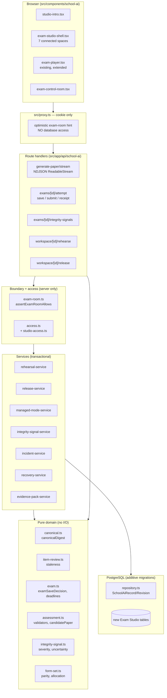
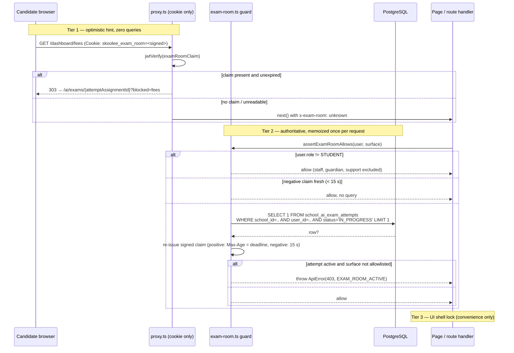
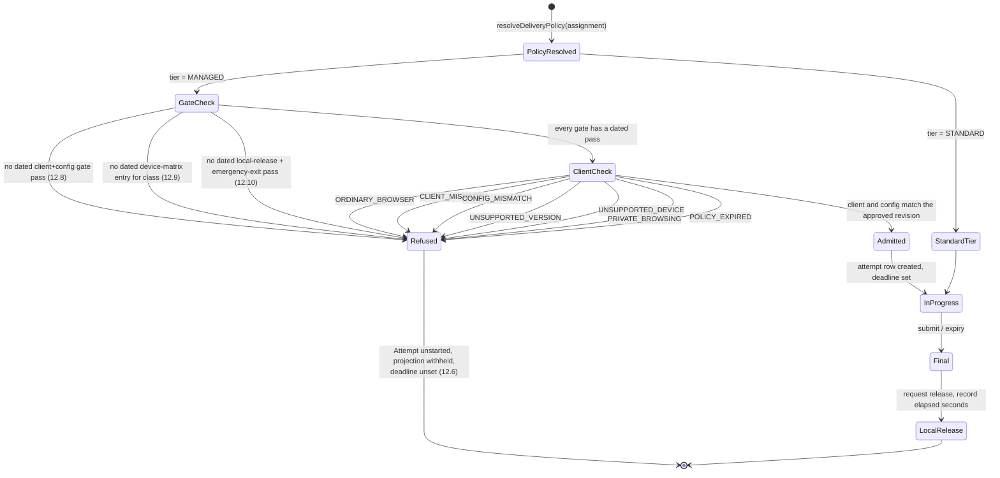
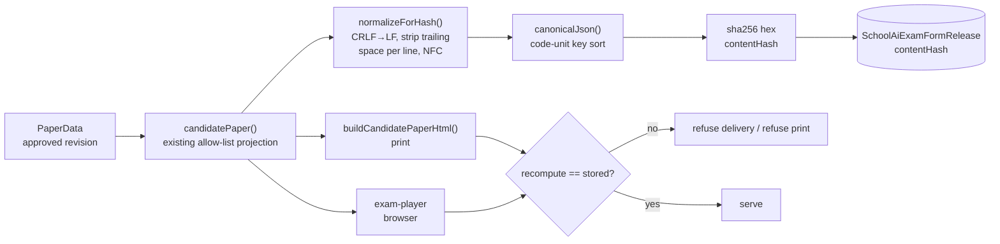
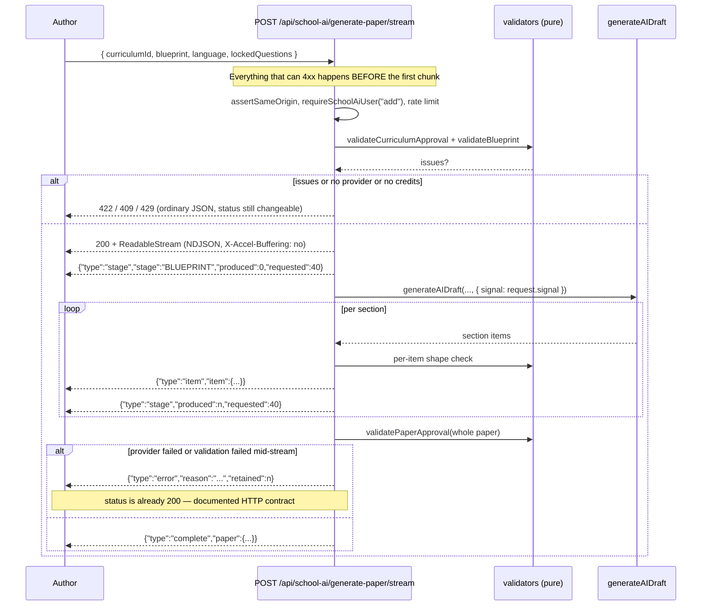
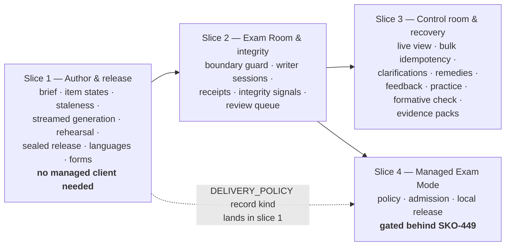

# Design Document

## Overview

SKO-408 AI Exam Studio is built as an **additive layer over the existing School AI assessment stack**, not as a new subsystem. Every versioning, approval, scoping and audit guarantee the requirements ask for already exists in `SchoolAiRecord`/`SchoolAiRevision`, `src/lib/school-ai/access.ts` and `src/lib/school-ai/transaction.ts`. The design therefore spends its new surface on the four things that genuinely do not exist yet: an app-level **Exam Room boundary**, a policy-gated **Managed Exam Mode admission** path, a **factual integrity signal** stream with no authority over outcomes, and a **sealed release** whose print and browser output can be proven identical.

Three framing facts drive the whole design.

**The standard browser path is never replaced.** `assertSupportedExamMode()` in `src/lib/school-ai/exam.ts` currently throws for `SECURE_BROWSER` and `PROCTORED`; `src/lib/school-ai/exam-service.ts` turns that into HTTP 409 at two sites (`scopedAssignment`, `createSchoolAiExam`). This design replaces the blanket refusal with a Delivery-Policy-driven decision that *still refuses by default* and only admits a managed client when a named validation gate has a dated pass result. The function keeps its fail-closed shape; it gains a policy argument.

**Nothing here claims a cheat-proof exam.** Two lock tiers exist and are labelled separately everywhere: the app-level Exam Room boundary (server-enforced, in scope) and Managed Exam Mode device lockdown (client owned by SKO-449, in scope only as policy records, admission gating and honest interface state). The integrity pipeline is typed so that no code path can let a signal change a mark, a deadline, an attempt state or a release.

**Framework APIs are taken from the installed guides, not from memory.** Next.js 16.2.3 renamed Middleware to Proxy and changed the caching model. Section "Framework constraints" below records exactly which installed documents each decision rests on.

### Framework constraints (read before writing routing, proxy, streaming or caching code)

Documents read for this design, all under `node_modules/next/dist/docs/`:

| Document | What it settles for this design |
| --- | --- |
| `01-app/01-getting-started/16-proxy.md` | Middleware is renamed **Proxy** as of Next.js 16; same functionality. Proxy is explicitly *not* intended for data fetching and should be used for optimistic checks only, "not as a full session management or authorization solution." |
| `01-app/03-api-reference/03-file-conventions/proxy.md` | The `middleware` file convention is **deprecated**, renamed `proxy`; one proxy function per project, default or named `proxy` export. Proxy "is meant to be invoked separately of your render code and in optimized cases deployed to your CDN… you should not attempt relying on shared modules or globals." Proxy defaults to the Node.js runtime and the `runtime` config option **throws** if set in a proxy file. Critically: **Server Functions are not separate routes in the matcher chain** — they are POST requests to the route that uses them, so a matcher change can silently remove proxy coverage, and "always verify authentication and authorization inside each Server Function rather than relying on Proxy alone." |
| `01-app/02-guides/data-security.md` | Recommends a server-only **Data Access Layer** that performs authorization and returns minimal DTOs; `import 'server-only'` to keep server modules off the client. |
| `01-app/01-getting-started/15-route-handlers.md`, `01-app/03-api-reference/03-file-conventions/route.md` | Route Handlers are not cached by default; `GET` can opt in via `dynamic = 'force-static'`. `context.params` is a **promise** since 15.0 and must be awaited. Segment config available: `dynamic`, `dynamicParams`, `revalidate`, `fetchCache`, `runtime`, `preferredRegion`. Streaming from a handler uses the Web Streams API (`ReadableStream` + `TextEncoder`). |
| `01-app/02-guides/streaming.md` | **The HTTP contract**: once the first chunk is sent the status code and headers are fixed and cannot be changed. Reverse proxies and CDNs buffer by default; disable with `X-Accel-Buffering: no`. Route Handlers can stream raw responses outside React rendering. |
| `01-app/01-getting-started/08-caching.md` | `use cache` / Cache Components behaviour applies only when `cacheComponents: true`. **`next.config.ts` in this repository does not set it**, so Exam Studio stays on the previous model: Route Handlers dynamic by default, no `use cache`, no `cacheLife`/`cacheTag`. |
| `01-app/01-getting-started/07-mutating-data.md` | Server Functions are reachable by direct POST, independent of the UI, and must authorize themselves. `refresh()` from `next/cache` refreshes the router without revalidating tags. |
| `01-app/03-api-reference/03-file-conventions/02-route-segment-config/maxDuration.md` | `maxDuration` is seconds, per route segment; for Server Actions it is set at page level. |
| `03-architecture/accessibility.md`, `01-app/01-getting-started/05-server-and-client-components.md`, `01-app/01-getting-started/11-css.md` | Already cited as prerequisites by `docs/ui-plan/component-contracts.md §1`; re-read before each UI edit. |

Two consequences are load-bearing and appear again below:

1. **The Exam Room boundary cannot live in `src/proxy.ts`.** The file documents its own cookie-only contract, and the installed proxy reference confirms both that proxy must not depend on shared modules and that Server Functions bypass matcher coverage entirely. Enforcement goes next to the data (Requirement 11.3 says exactly this).
2. **A streamed generation response cannot report a late failure as a 4xx.** Authorization, credits and blueprint validation all run *before* the first chunk; a mid-stream failure becomes a terminal NDJSON error frame under an already-sent `200`.

### What is reused unchanged

| Capability | Existing module | Exam Studio relationship |
| --- | --- | --- |
| Curriculum, outcomes, taught coverage | `curriculumDataSchema`, `validateCurriculumApproval` | read-only input to the Assessment Brief |
| Blueprint, items, keys, rubrics, bank provenance | `blueprintSchema`, `questionSchema`, `paperDataSchema`, `validateBlueprint`, `validatePaperApproval` | `questionSchema` gains one optional `review` object; validators gain additional checks, no rewrites |
| Whole-paper generation | `POST /api/school-ai/generate-paper`, `prepareGeneratedQuestions`, `mergeLockedQuestions` | kept as the non-streaming path; a streaming sibling and a single-item path are added |
| Key-blind semantic review | `semanticReviewSchema`, `generatePaperSemanticReview`, `latestSemanticReview` (stored in `AIUsageLog` keyed by `recordId`+`recordVersion`) | becomes one rehearsal check; the version key already gives staleness for free |
| Reviewed figure crops | `paper-figures.ts`, `paper-figure-service.ts` | feeds the figure completeness rehearsal check |
| Versioning, approval, revisions, CAS, audit | `repository.ts`, `transaction.ts` | the record chain of Requirement 25 **is** this module; Exam Studio adds record kinds, not a parallel store |
| Candidate projection and print | `candidatePaper()`, `buildCandidatePaperHtml()` | both become Content-Hash-verified outputs |
| Delivery and attempts | `examAssignmentSchema`, `saveExamSchema`, `examSaveDecision`, `attemptDeadline`, `exam-service.ts`, `exam-expiry.ts` | extended with writer sessions, receipts and form-set grouping |
| Capture | `exam-proctor.ts`, `exam-proctor-service.ts`, `exam-proctor-sweep.ts`, `SchoolAiProctorSession/Clip` | the consent, container-signature and 1–7 day retention model is already correct; Exam Studio only adds the `CAPTURE_UNAVAILABLE` signal and the honest indicator |
| Marking, moderation, results | `scoreObjectiveResponses`, `validateExamReview`, `written-marking-service.ts`, `exam-results.ts`, `SchoolAiExamResultRevision`, `SchoolAiExamAppeal`, `exam-gradebook-service.ts`, `exam-script-service.ts` | remedy application creates new result revisions through these records |
| Scope enforcement | `access.ts` (`canAccessWorkspaceRecord`, `assertWorkspaceSubject`, `loadWorkspacePermissionSnapshot`) | Studio_Access is this file plus one new authority matrix table |
| Provider access | `src/lib/ai/openai.ts` (`generateAIDraft`, `ensureAICreditsAvailable`, `consumeAICreditAndLog`), `providers.ts`, `intake.ts` | unchanged; generation adds an `AbortSignal` and a per-item prompt |

### Resolution of the three open items

**Open item 1 — R2.4 separation of authoring and approval.** The criterion is conditional on "the school policy record requires separation of authoring and approval", and no such record exists. **Decision: introduce it, and introduce it as a field on the Delivery Policy record that Requirement 12 already needs** — not as a new table.

The Delivery Policy is stored as a **new `SchoolAiRecord` kind, `"DELIVERY_POLICY"`**. `SchoolAiRecord.kind` is a plain `String` column, and `allowedWorkspaceKinds()` already gates kinds by role, so a new kind is a code-only change: no migration, and the record inherits versioning, `APPROVED` status, immutable `SchoolAiRevision` snapshots, campus scoping, CAS-on-version and audit logging. Requirement 12.2 ("versioned, approvable record") and Requirement 12.3 (Academic_Approver approval before it governs an Attempt) are then satisfied by machinery that already exists and is already tested.

`separationOfDuties: "NOT_REQUIRED" | "REQUIRED"` lives on that record. `assertApprovalRole()` keeps its current signature and a new `assertApprovalSeparation(user, record, policy)` is called beside it. When no approved Delivery Policy exists for a scope, the resolved policy is the **built-in default**, which sets `separationOfDuties: "NOT_REQUIRED"` — so R2.4 degrades to always-allow *and says so in the interface*, rather than silently blocking approvals in schools that have not configured a policy. Migration impact: none. Interface impact: the approval button carries the resolved policy source (`school policy` or `platform default`).

**Open item 2 — the Studio_Intro 1800 ms budget.** R20.2 states an upper bound ("SHALL complete within 1800 milliseconds"), not a target. **Decision: keep 1800 ms as the contractual ceiling and build the sequence at 1100 ms**, leaving 700 ms of headroom for slow first paint. Rationale from the installed stack rather than taste: `framer-motion@^11.18.2` is already a dependency and three chat components already wrap trees in `MotionConfig reducedMotion="user"`, which is the only mechanism that stops JS-driven motion — `src/app/globals.css:723` forces `animation-duration`/`transition-duration` to `0.01ms !important` under `prefers-reduced-motion`, and `docs/ui-plan/tokens-and-styles.md` states plainly that this CSS rule does **not** control Framer Motion. So reduced motion needs both the existing CSS and an explicit JS branch.

Reduced-motion fallback is specified exactly: `useReducedMotion()` returning true renders a **single static assistant mark with no `transform` and no `opacity` keyframes at all** — the final frame is the first frame — and `onComplete` fires on the next animation frame, so the measured duration is one frame (well inside the 200 ms of R20.5) and no `transform` animation exists to be removed (R20.4).

**Open item 3 — the Form_Set maximum.** **Decision: a hard bound of 4 parallel forms (A–D), enforced in three places.** (a) `formSetSchema.labels` is `z.array(formLabelSchema).min(1).max(4)` — a schema bound a request cannot exceed. (b) `deliveryPolicySchema.maxForms` is `z.number().int().min(1).max(4)`, so a school may configure *down* from 4 but never up. (c) `Release_Service` re-reads the approved policy inside the release transaction and refuses the Form_Set if `labels.length > policy.maxForms`. The bound is chosen to stay inside existing limits rather than invent a new one: `paperDataSchema.questions` is capped at 100 and `examAssignmentSchema.studentIds` at 500, so 4 forms is at most 400 items and 2000 exposure-ledger rows per release — bounded work for the parity check, which is O(forms × sections).

## Architecture

### Layering

Exam Studio keeps the repository's existing three-layer shape: **pure domain modules** (no I/O, node `--test` runnable), **services** (transactional, authorization-bearing), **route handlers and components** (thin). New code is placed to preserve that split, because the test strategy depends on it: `test:school-ai` runs only non-`.database.test.ts` files and `test:school-ai:db` refuses any non-loopback `DATABASE_URL`.



### Decision: where the Exam Room boundary is enforced

**`src/proxy.ts` is not the enforcement point, and must not become one.** The file already documents why: it verifies the JWT signature only and deliberately skips the revocation check because that is a database read on every non-asset request, including every router prefetch. The installed proxy reference independently confirms the constraint — proxy must not rely on shared modules, may be hoisted to a CDN, and does not even see Server Function calls as routes. Putting a boundary check there would be both expensive and incomplete.

Enforcement is therefore a **three-tier arrangement**, with the authoritative tier next to the data.



**Why the claim cannot outlive a real attempt.** `skoolee_exam_room` is a separate `httpOnly`, `SameSite=Lax`, `Secure` cookie signed with the existing `JWT_SECRET` through `jose`, carrying `{ k: "exam-room", attemptId, assignmentId, deadlineAt, writerSessionId }`. Its `Max-Age` is set to the seconds remaining until `deadlineAt`, so the cookie expires at the authoritative deadline by construction — a positive claim has no way to survive the attempt. Trust is asymmetric and deliberately so:

- A **positive** claim only ever *adds* restriction. A replayed stale positive claim narrows the candidate's own access and cannot extend time, because `attemptDeadline()` and every write still read the attempt row.
- A **negative** claim (`{ k: "exam-room", none: true }`) is signed, so it cannot be forged, and carries a 15 s TTL. The only route to a stale negative is starting an attempt in a *different* session, and that session is revoked as writer by R11.7/11.8 regardless. The attempt-start response always rewrites the positive claim in the session that started it.
- A **missing or unreadable** claim falls through to the database read. Deleting the cookie buys a candidate one indexed query, not an escape.

**Query cost.** The guard runs for `user.role === "STUDENT"` only (R11.9 excludes staff, guardians and Platform_Support), is memoized per request with React `cache()` for server components and by an explicit single call in route handlers, and is backed by a new partial index `school_ai_exam_attempts (school_id, user_id) WHERE status = 'IN_PROGRESS'`. With the negative claim in place, a student browsing normally pays one query per 15 s, not one per request.

**The allowlist, precisely.** `EXAM_ROOM_PAGE_ALLOWLIST` and `EXAM_ROOM_SURFACE_ALLOWLIST` are frozen arrays in `src/lib/school-ai/exam-room.ts`:

| Surface | Path | Allowed while an attempt is active | Refusal |
| --- | --- | --- | --- |
| Attempt page | `/ai/exams/[id]` for the active assignment only | yes | other `[id]` → 303 to the active one |
| Sign-out | `/logout`, `POST /api/auth/logout` | yes | — |
| Identity refresh | `GET /api/auth/session` | yes | — |
| Exam assets | `GET /api/school-ai/exams/[id]` (meta, duration, server clock) | yes | — |
| Candidate paper + figures | `GET /api/school-ai/exams/[id]/attempt` | yes | — |
| Answer save / submit | `POST /api/school-ai/exams/[id]/attempt` | yes | — |
| Receipt | `GET /api/school-ai/exams/[id]/attempt/receipt` | yes | — |
| Approved accommodations | included in the attempt payload, no separate surface | yes | — |
| Clarification notices | `GET /api/school-ai/exams/[id]/clarifications` | yes | — |
| Integrity signal report | `POST /api/school-ai/exams/[id]/integrity-signals` | yes | — |
| Capture upload | `POST /api/school-ai/exams/[id]/proctor`, `…/proctor/sessions/[sessionId]/clips` | yes | — |
| Attempt support pages | only paths listed in the approved Delivery Policy `attemptSupportPaths` | yes | — |
| Help | the in-attempt help panel is static copy inside the attempt page, no network | yes | — |
| **Everything else** | any other page | — | **303** to the attempt page with `?blocked=<surface>` |
| **Everything else** | any other route handler | — | **403** `{ error, code: "EXAM_ROOM_ACTIVE", assignmentId }` |

Status codes: pages get `303 See Other` so a form POST does not re-submit on redirect; interfaces get `403` with a machine code rather than `423 Locked`, because `403` is already the repository's refusal vocabulary (`errorResponse` in `src/lib/api/scope.ts`) and existing clients already recover from it. The refusal body names the active attempt and nothing else — no Protected_Key value, no other candidate's data (R11.5). Save state and remaining time stay readable at every point including while a refusal is displayed (R11.12), because the attempt read surface is itself allowlisted.

**Indeterminate state (R11.13).** If the guard cannot decide — the claim is unreadable *and* the query fails — it permits the attempt page, refuses every write, and writes a `SchoolAiIntegritySignal` of type `EXAM_ROOM_INDETERMINATE` with `INFORMATION` severity for staff review. It never fails open on a write.

**SKO-411 relationship.** The shared focused-session boundary is owned by SKO-411. Exam Studio implements the Exam-Studio-facing contract only: the allowlist, the candidate refusal behaviour and the honest labelling. `exam-room.ts` exports its decision function so SKO-411 can supply the session primitive without Exam Studio reimplementing it (R11.11, R29.3).

### Decision: Managed Exam Mode admission

The current code fails closed by throwing from a pure function. The replacement keeps that property and makes the refusal *reasoned* instead of blanket.



`assertSupportedExamMode()` changes shape rather than disappearing:

```ts
// src/lib/school-ai/exam.ts  (pure, no I/O)
export type ExamMode = "STANDARD" | "SECURE_BROWSER" | "PROCTORED";

/** Fail-closed by default. A mode other than STANDARD requires an approved
 *  policy revision whose validation gates all carry a dated pass result. */
export function assertSupportedExamMode(
  mode: ExamMode,
  policy?: ResolvedDeliveryPolicy,
): void;
```

Called with one argument it behaves exactly as today — `STANDARD` passes, everything else throws with the existing `/not enabled/` message. That keeps every current call site correct while the policy plumbing lands. **`tests/school-ai/assessment.test.ts:67` ("unsupported secure/proctored modes fail closed") must be updated, not deleted**: it keeps its two existing single-argument assertions verbatim as the default-refusal case, and gains cases for a gate-open policy (still throws, new message naming the open gate) and a fully-gated policy (does not throw).

**Client verification is integration, never attestation.** Safe Exam Browser's documented mechanism is a request header — SEB sends `X-SafeExamBrowser-ConfigKeyHash` and `X-SafeExamBrowser-RequestHash`, each a SHA-256 over the request URL concatenated with the Config Key or Browser Exam Key, which the server recomputes and compares ([SEB developer integration notes](https://www.safeexambrowser.org/developer/seb-integration.html); the Browser Exam Key specification states the hash is evidence that the client "is correctly configured/secured for this specific exam" — [SEB-Specification-BrowserExamKey.pdf](https://raw.githubusercontent.com/SafeExamBrowser/SafeExamBrowser-Website/master/developer/documents/SEB-Specification-BrowserExamKey.pdf)). A header is not a hardware attestation: published tooling appends these headers from an ordinary browser extension to reach SEB-gated pages ([nSEA](https://github.com/Chiogros/nSEA)). The design therefore treats a matching hash as **evidence of configuration, recorded as such**, and the interface says so. Content was rephrased for compliance with licensing restrictions.

Consequences written into the design:

- The hash is verified **server-side on every allowlisted attempt surface**, not once at admission, because a per-request header check is the only thing the mechanism actually offers.
- `Admission_Decision` stores the **first 16 hex characters** of the received hash, never the key and never the full hash, so a stored audit row cannot be replayed as a credential.
- The Config Key and Browser Exam Key are read from server configuration only (`SCHOOL_AI_SEB_CONFIG_KEY`, `SCHOOL_AI_SEB_EXAM_KEY`), never stored in a `SchoolAiRecord` and never returned to a client.
- `Local_Release` targets **120 s**, recorded on the policy as `localReleaseSeconds` with a `z.number().int().min(1).max(120)` bound, and the measured elapsed seconds are stored per attempt (R12.11).
- The **emergency exit is independent of Skoolee AI availability** — it is a client-side quit password path on the managed client, documented on the policy as `emergencyExitPath`, and each use is recorded when the client next reaches the server. If the server is unreachable the exit still works; the record arrives late. That is stated in the interface.
- **The shipping claim for Managed Exam Mode depends on the SKO-449 gates passing on real devices.** Until then every gate is `EXTERNAL_GATE_OPEN` in the Commercial Evidence Register, the Studio Workspace shows Managed Exam Mode as unavailable with the named gate and owner, and no copy says device lockdown is active (R12.17, R12.18, R1.3).

**One existing path must change with it.** `src/lib/school-ai/exam-expiry.ts` filters `e.mode = 'STANDARD'` in both reference queries and in the locked per-attempt read. If managed attempts are admitted without that filter widening, their deadlines would never be swept. The migration slice that enables managed admission also widens that filter to the set of admitted modes and adds a database test for a managed attempt expiring.

### Decision: Content Hash



The repository already has the right pattern in `repository.ts`: a private `canonical()` that sorts object keys recursively, then `createHash("sha256").update(JSON.stringify(canonical(value)))`. **Decision: extract it to a shared module and fix one latent determinism bug in the new function only.**

`canonical()` sorts keys with `localeCompare`, which is ICU-locale-dependent. For a hash an independent verifier must be able to recompute outside Skoolee AI (R19.3), that is not acceptable. So:

- `src/lib/school-ai/canonical.ts` exports `canonicalJson(value): string` using a **code-unit** comparator (`a < b ? -1 : a > b ? 1 : 0`) and `canonicalDigest(value): string`.
- `workspaceRequestHash()` keeps its **current `localeCompare` behaviour unchanged**, because `SchoolAiRecord.requestHash` is persisted and compared against stored values; changing it would break idempotency replay on existing rows. It moves into `canonical.ts` as `legacyWorkspaceRequestHash` and is re-exported from `repository.ts` under its existing name, so no call site changes.
- `contentHash()` prefixes a scheme version: `canonicalDigest({ v: 1, language, formLabel, projection })`. R9.9 requires a separate hash per language version, and the language is inside the hash input, so two language versions cannot collide.

Whitespace normalization is defined exactly and applies **to the hash input only, never to stored or rendered content**: `\r\n` and `\r` → `\n`; trailing spaces and tabs removed at each line end; Unicode NFC normalization. Protected_Key values are absent by construction because the input is `candidatePaper()`, whose doc comment already states it is an explicit allow-list (R8.6).

### Decision: per-item review state and staleness live in `paperData`

**Decision: inside the `paperData` JSON, as an optional field on `questionSchema`, plus a form-level staleness object — not new relational tables.**

| Consideration | JSON in `paperData` | New relational tables |
| --- | --- | --- |
| Migration surface | none | 2–3 tables with their own tenant scoping |
| Version semantics | **item state is a property of a record version**; `SchoolAiRevision` already snapshots `data` immutably, so R6.6 ("retain every invalidated observation, keyed by the record version that produced it") is satisfied with zero new code | needs its own version column, kept in sync by hand |
| Concurrency | inherits the existing CAS-on-`version` in `updateWorkspaceRecordInTransaction` | second write path, second conflict story |
| Release blocking (R4.10) | a pure addition to `validatePaperApproval`, runnable under `test:school-ai` with no database | needs a database test |
| Drift risk | impossible — the state travels with the content it describes | a row can describe a paper version that no longer exists |
| Cross-record queries | **not possible** | possible |

The last row is the real trade, and it draws the line for the whole design: **state that describes one record version goes in the JSON; state that must be queried across records goes relational.** So item review state, staleness and language-group links are JSON; the Exposure Ledger, Integrity Signals, Admission Decisions, Attempt Receipts, form allocations, clarifications, remedies and evidence packs are tables, because each one is read by cohort, by date, by queue or by sweep.

Transitive invalidation is a **pure function over one paper**, which is why it can live in the JSON at all: `applyStaleness(paper, change)` returns a new `PaperData` with every dependent artifact marked invalid. The dependency graph is fixed and shallow — prompt/options/marks → key, rubric, semantic observation, item approval; figures → figure check, item approval; source version → `NEEDS_SOURCE`; any invalid item → form rehearsal result. One pass, no recursion needed, fully testable without I/O.

### Decision: streamed generation

The existing `POST /api/school-ai/generate-paper` stays exactly as it is — it is the fallback when streaming is buffered by an intermediary, and `exam-preflight.tsx`/`assessment-studio.tsx` already depend on its single-JSON contract. A sibling route streams.



Frame grammar (`src/lib/school-ai/generation-stream.ts`, pure):

```ts
export const generationFrameSchema = z.discriminatedUnion("type", [
  z.object({ type: z.literal("stage"), stage: z.enum(["BLUEPRINT","ITEMS","KEYS","REVIEW"]),
             produced: z.number().int().min(0), requested: z.number().int().min(0) }).strict(),
  z.object({ type: z.literal("item"), item: questionSchema }).strict(),
  z.object({ type: z.literal("error"), reason: z.string().max(400),
             retained: z.number().int().min(0) }).strict(),
  z.object({ type: z.literal("cancelled"), retained: z.number().int().min(0),
             at: z.string().datetime() }).strict(),
  z.object({ type: z.literal("complete"), paper: paperDataSchema }).strict(),
]);
export function encodeFrames(frames: AsyncIterable<GenerationFrame>): ReadableStream<Uint8Array>;
export function decodeFrames(stream: ReadableStream<Uint8Array>): AsyncIterable<GenerationFrame>;
```

The `error` frame carries a reason string only; no provider body and no stack trace ever reaches it (R5.9, R26.9). `retained` tells the client how many items survive, satisfying R5.9's "retain every item produced before the failure".

**Cancellation (R5.12).** The handler passes `request.signal` into `generateAIDraft`. On abort it stops consuming the provider, emits a `cancelled` frame if the stream is still writable, and records the cancellation with the authoritative timestamp through `consumeAICreditAndLog` with `action: "GENERATE_CANCELLED"` and the tokens actually consumed — so a cancelled request is charged for what it used and no more.

**Single-item regeneration (R5.3).** `POST /api/school-ai/workspace/[id]/items/[questionId]/regenerate`, `maxDuration = 30`, non-streaming because one item fits one response. It returns `{ previous, candidate, differingFields }` and **writes nothing**. The Author accepts or rejects in a second call, which is what makes "preserve every other item byte-for-byte" checkable: the merge is `replaceOneQuestion(paper, questionId, candidate)`, a pure function that copies every other element by reference.

### Decision: parallel forms and language versions

`paperDataSchema.language` stays a single value. Multiplying it would invalidate `buildCandidatePaperHtml()`, `candidatePaper()`, the assignment snapshot and the scan path all at once.

Instead: **one `SchoolAiRecord` of kind `PAPER` per (form, language)**, linked by shared identifiers carried inside `paperData`:

```ts
// additive, optional fields on paperDataSchema
formSet: z.object({
  id,                                    // shared across the Form_Set
  label: z.enum(["A","B","C","D"]),
  blueprintHash: z.string().length(64),  // canonicalDigest(blueprint) — parity key
}).strict().optional(),
itemGroupIds: z.record(id, id).optional(), // questionId -> shared item group id
```

Parity (R10.3, R10.4) is then a pure comparison of `blueprintHash` plus section totals across the records in the set, and `Language_Review` (R9.3–R9.5) is a pure comparison of two records joined on `itemGroupIds`. `MARKS_MISMATCH` and `KEY_STRUCTURE_MISMATCH` are deterministic; the model comparison of meaning is a proposal with `Signal_Uncertainty` requiring a human decision, and `Language_Review` never edits an item version automatically (R9.7).

**Freezing a candidate's form, and keeping every recovery path on it.** This is the part that has to be right once rather than in five places. One `SchoolAiExamAssignment` **per form**, grouped by a new `formSetId` column and labelled by `formLabel`. A new `SchoolAiExamFormAllocation` row maps `(formSetId, studentId) → assignmentId` with `@@unique([formSetId, studentId])`.

The payoff is that **every existing code path already resolves to exactly one assignment, and therefore to exactly one form, with no change at all**: `scopedAssignment()` loads one assignment; `assignment.paperSnapshot` is one paper; `startSchoolAiExam()`, `saveSchoolAiAttempt()`, `getSchoolAiAttempt()`, the expiry sweep, `exam-script-service.ts` (QR and scan) and `exam-results.ts` all key off `assignmentId`. Reload, reconnect, session takeover, expiry and paper-script scanning cannot disagree about which form a candidate sat, because none of them ever chooses a form. The unique constraint makes R10.8 ("exactly one form") a database invariant rather than a code convention, and R10.10 (no form change while an attempt is active) is a `FOR UPDATE` read of the allocation row plus an existence check on the attempt.

### Dependency and delivery order

Four slices, each independently verifiable, each shippable on its own.



| Slice | Requirements closed | Blocked by | External gate |
| --- | --- | --- | --- |
| 1 | 3, 4, 5, 6, 7, 8, 9, 10, 20, 21, 22 (authoring surfaces), 24 (authoring states), 25, 26, 2 (author/approver rows) | nothing | educational calibration (reported, not blocking) |
| 2 | 11, 13, 14, 16, 23 (attempt page) | slice 1 release records | none |
| 3 | 15, 17, 18, 19, 27, 28, 29 | slice 2 attempts and signals | SKO-413 sittings, SKO-424/422 moderation |
| 4 | 12 | slice 2 boundary + slice 1 policy kind | **SKO-449 real-device gates — shipping claim depends on these** |

The `DELIVERY_POLICY` record kind lands in slice 1 even though Managed Exam Mode ships in slice 4, because slice 1 needs `separationOfDuties` and `maxForms` from the same record. Slice 1 writes the policy with `tier: "STANDARD"` and every managed gate recorded as open.

## Components and Interfaces

### New and changed files

| Path | Kind | Purpose |
| --- | --- | --- |
| `src/lib/school-ai/canonical.ts` | pure | `canonicalJson`, `canonicalDigest`, `normalizeForHash`, `legacyWorkspaceRequestHash` |
| `src/lib/school-ai/assessment-brief.ts` | pure | brief schema, question sequence, fact classification, readiness |
| `src/lib/school-ai/item-review.ts` | pure | item review states, transitions, `applyStaleness`, release blockers |
| `src/lib/school-ai/form-set.ts` | pure | form labels, blueprint parity, language comparison, allocation checks |
| `src/lib/school-ai/release.ts` | pure | `contentHash`, `verifyContentHash`, release preconditions |
| `src/lib/school-ai/rehearsal.ts` | pure | check registry, blocker classification, repair paths |
| `src/lib/school-ai/delivery-policy.ts` | pure | policy schema, gate resolution, admission reason codes |
| `src/lib/school-ai/integrity-signal.ts` | pure | signal schema, severity, uncertainty, grouping, rate budget |
| `src/lib/school-ai/exam-room.ts` | server-only | allowlists, claim encode/decode, `assertExamRoomAllows` |
| `src/lib/school-ai/attempt-receipt.ts` | pure | response digest, receipt shape, final-state resolution |
| `src/lib/school-ai/incident.ts` | pure | clarification versions, remedy proposal computation |
| `src/lib/school-ai/recovery.ts` | pure | feedback derivation, practice eligibility, outcome comparison |
| `src/lib/school-ai/evidence-pack.ts` | pure | manifest shape, digest list, gap entries |
| `src/lib/school-ai/exam-studio-copy.ts` | copy | EN/AR/UR strings for every new surface |
| `src/lib/school-ai/*-service.ts` (7 new) | service | transactional counterparts of the above |
| `src/lib/school-ai/exam.ts` | **changed** | `assertSupportedExamMode` gains an optional policy argument; writer-session decision added |
| `src/lib/school-ai/assessment.ts` | **changed** | `questionSchema.review?`, `paperDataSchema.formSet?`/`itemGroupIds?`/`staleness?`; `validatePaperApproval` gains item-state and figure-staleness checks |
| `src/lib/school-ai/access.ts` | **changed** | `allowedWorkspaceKinds` adds `DELIVERY_POLICY` and `PRACTICE`; `assertApprovalSeparation` added |
| `src/lib/school-ai/exam-service.ts` | **changed** | writer sessions, receipts, policy-gated admission, form allocation |
| `src/lib/school-ai/exam-expiry.ts` | **changed** | mode filter widened from `'STANDARD'` to the admitted-mode set |
| `src/lib/school-ai/repository.ts` | **changed** | re-exports `workspaceRequestHash` from `canonical.ts`; validates two new kinds |

### Studio access and the authority matrix

Requirement 2 is 16 criteria of role authority. Expressing it as scattered `if` statements would guarantee drift, so it becomes **one frozen table plus one lookup**, in `src/lib/school-ai/studio-access.ts`:

```ts
export type StudioRole =
  | "AUTHOR" | "ACADEMIC_APPROVER" | "INVIGILATOR" | "MODERATOR"
  | "CANDIDATE" | "GUARDIAN" | "PLATFORM_SUPPORT";

export type StudioAction =
  | "AUTHOR_ITEM" | "RUN_REHEARSAL" | "APPROVE_VERSION" | "APPROVE_POLICY"
  | "ADMIT_CLIENT" | "GRANT_EXTRA_TIME" | "SUPERVISED_PAUSE" | "REQUEST_LOCAL_RELEASE"
  | "DECIDE_SIGNAL" | "READ_SIGNAL" | "READ_PROTECTED_KEY" | "READ_RESPONSE_BODY"
  | "READ_CAPTURE" | "READ_UNRELEASED_RESULT" | "RELEASE_RESULT"
  | "AUTHORIZE_REMEDY" | "RECORD_MODERATION" | "EDIT_RELEASED_FORM"
  | "DELETE_SIGNAL" | "EXPORT_EVIDENCE_PACK" | "READ_EXPOSURE_LEDGER"
  | "READ_CANDIDATE_PROJECTION" | "READ_OWN_RESULT" | "READ_LINKED_RELEASED_RESULT"
  | "READ_CONFIGURATION" | "READ_FAILURE_DIAGNOSTICS";

/** Explicit allow-list. An action absent from a role's set is refused.
 *  Frozen so no runtime code can widen it. */
export const STUDIO_AUTHORITY: Readonly<Record<StudioRole, ReadonlySet<StudioAction>>>;

/** Maps the platform role plus assignment context onto the studio roles held. */
export function studioRolesFor(
  user: AuthUser,
  context: { assignmentId?: string; isAssignedInvigilator?: boolean;
             isModerating?: boolean; hasSupportGrant?: boolean },
): ReadonlySet<StudioRole>;

/** Throws SchoolAiError(403) unless some held studio role allows the action.
 *  Loads the permission snapshot inside the same request (R2.15). */
export async function assertStudioAction(
  user: AuthUser,
  action: StudioAction,
  context: StudioActionContext,
  permissions?: WorkspacePermissionSnapshot,
): Promise<void>;

/** Append-only authority record for every action in Requirement 2 (R2.16). */
export async function recordStudioAction(
  tx: TxClient, user: AuthUser,
  entry: { action: StudioAction; targetId: string; targetVersion: number },
): Promise<void>;
```

`studioRolesFor` composes over the existing primitives rather than replacing them: `isSchoolAiManager(user)` yields `ACADEMIC_APPROVER`, `user.role === "TEACHER"` with an `getAssignedWorkspaceSubjects` hit yields `AUTHOR`, `user.role === "STUDENT"` yields `CANDIDATE`, `"PARENT"` yields `GUARDIAN`, `"APP_OWNER"` with a live `skoolee_support_grant` cookie yields `PLATFORM_SUPPORT`. Refusals are the default: R2.2, R2.6, R2.8, R2.10, R2.12 and R2.14 need no code, because the actions are simply absent from those roles' sets. A per-request permission snapshot (`loadWorkspacePermissionSnapshot`, already written for exactly this purpose) makes R2.15 true without a cache to go stale.

### Exam Room guard

```ts
// src/lib/school-ai/exam-room.ts
import "server-only";

export const EXAM_ROOM_COOKIE = "skoolee_exam_room";
export const EXAM_ROOM_NEGATIVE_TTL_SECONDS = 15;

export const EXAM_ROOM_SURFACE_ALLOWLIST: readonly ExamRoomSurface[];
export const EXAM_ROOM_PAGE_ALLOWLIST: readonly string[];

export type ExamRoomSurface =
  | "ATTEMPT_PAGE" | "ATTEMPT_READ" | "ATTEMPT_SAVE" | "ATTEMPT_SUBMIT"
  | "ATTEMPT_RECEIPT" | "EXAM_META" | "CLARIFICATIONS" | "INTEGRITY_REPORT"
  | "CAPTURE_UPLOAD" | "IDENTITY_REFRESH" | "SIGN_OUT" | "SUPPORT_PAGE" | "OTHER";

export type ExamRoomDecision =
  | { state: "NOT_APPLICABLE" }                                   // staff, guardian, support
  | { state: "ALLOWED"; attemptId?: string }
  | { state: "REFUSED"; assignmentId: string; attemptId: string; surface: ExamRoomSurface }
  | { state: "INDETERMINATE" };                                   // R11.13

/** Pure: the whole allowlist decision, testable with no database. */
export function examRoomDecision(input: {
  role: string;
  active: { attemptId: string; assignmentId: string } | null;
  surface: ExamRoomSurface;
  requestedAssignmentId: string | null;
  supportPaths: readonly string[];
}): ExamRoomDecision;

/** Signed claim. Positive claims expire at the authoritative deadline. */
export async function issueExamRoomClaim(
  claim: { attemptId: string; assignmentId: string; deadlineAt: Date; writerSessionId: string }
    | { none: true },
): Promise<{ name: string; value: string; options: ResponseCookieOptions }>;
export async function readExamRoomClaim(raw: string | undefined): Promise<ExamRoomClaim | null>;

/** Authoritative. Memoized per request; queries only for STUDENT with no fresh claim. */
export const resolveActiveAttempt: (user: AuthUser) =>
  Promise<{ attemptId: string; assignmentId: string; deadlineAt: Date } | null>;   // React cache()

export async function assertExamRoomAllows(
  user: AuthUser, surface: ExamRoomSurface, requestedAssignmentId?: string,
): Promise<void>;                                   // throws ApiError(403, "EXAM_ROOM_ACTIVE")

export async function examRoomRedirect(user: AuthUser, pathname: string): Promise<Response | null>;
```

`src/proxy.ts` gains exactly one block, and it stays cookie-only — no import that could drag Prisma or `next/headers` into the proxy, honouring both the file's existing note and the installed reference:

```ts
// after the existing jwtVerify(token, JWT_SECRET) block, before the role routing guard
if (role === "STUDENT" && !pathname.startsWith("/api")) {
  // Optimistic hint only. The authoritative check is assertExamRoomAllows(),
  // reached by every page, layout, route handler and Server Function.
  const hint = req.cookies.get("skoolee_exam_room")?.value;
  const claim = hint ? await verifyExamRoomHint(hint) : null;   // jose only, no db
  if (claim && !claim.none && !isAttemptPath(pathname, claim.assignmentId)) {
    const url = new URL(`/ai/exams/${claim.assignmentId}`, req.url);
    url.searchParams.set("blocked", pathname);
    return NextResponse.redirect(url, 303);
  }
}
```

### Attempt durability, writer sessions and receipts

`examSaveDecision()` already returns `SAVE | REPLAY | STALE | EXPIRED | FINISHED` and already encodes R16.3 and R16.4 correctly. It gains one input and one outcome for writer takeover:

```ts
// src/lib/school-ai/exam.ts
export type SaveDecision = "SAVE" | "REPLAY" | "STALE" | "EXPIRED" | "FINISHED" | "REVOKED";

export function examSaveDecision(input: {
  status: string; sequence: number; currentSequence: number;
  deadlineAt: Date; now: Date; submit: boolean;
  writerSessionId?: string;          // the saving session
  currentWriterSessionId?: string;   // the admitted writer
}): SaveDecision;
```

`REVOKED` is returned when both session ids are present and differ — ahead of the `EXPIRED`/`STALE` checks, so a delayed offline save from a superseded session is refused on its own terms rather than being misreported as stale (R11.8, R16.8). Service maps it to `403 { code: "WRITER_REVOKED" }`.

```ts
// src/lib/school-ai/attempt-receipt.ts  (pure)
export const attemptReceiptSchema = z.object({
  attemptId: id, finalState: z.enum(["SUBMITTED","EXPIRED","VOIDED_BY_FAULT"]),
  responseDigest: z.string().length(64), contentHash: z.string().length(64),
  finalAt: z.string().datetime(), finalSequence: z.number().int().min(0),
  language: assessmentLanguageSchema, formLabel: z.enum(["A","B","C","D"]).optional(),
}).strict();

/** canonicalDigest over the normalized response map. Order-independent. */
export function responseDigest(responses: ExamResponses): string;

/** Single resolution point for the submit/expiry race (R16.6). */
export function resolveFinalState(input: {
  submitRequested: boolean; now: Date; deadlineAt: Date; status: string;
}): { finalState: AttemptFinalState; finalAt: Date } | null;
```

`SchoolAiAttemptReceipt` has `attemptId` as a **unique** column, and the receipt is written inside the same serializable transaction that sets the final state. One row is possible, so R16.5 ("exactly one") and R16.7 (identical on every repeat) are database facts rather than careful code. A duplicate submit or a concurrent expiry sweep hits the unique constraint, is translated to a read of the existing row, and returns the identical receipt.

### Rehearsal service

```ts
// src/lib/school-ai/rehearsal.ts  (pure)
export type RehearsalCheck =
  | "BLUEPRINT" | "PAPER_APPROVAL" | "SEMANTIC_REVIEW" | "FIGURE_COMPLETENESS"
  | "CANDIDATE_KEY_SEPARATION" | "PRINT_PAGINATION" | "KEYBOARD_NAVIGATION"
  | "SAVE_SUBMIT_REHEARSAL" | "ITEM_REVIEW_STATE" | "LANGUAGE_PARITY" | "FORM_PARITY";

export const rehearsalResultSchema = z.object({
  check: z.enum([...]), outcome: z.enum(["PASS","BLOCKING","ADVISORY"]),
  itemIds: z.array(id).max(100), owner: z.enum(["AUTHOR","ACADEMIC_APPROVER","PLATFORM_SUPPORT"]),
  repairPath: z.object({ space: z.enum(["BRIEF","BLUEPRINT","REVIEW","REHEARSAL","SETTINGS"]),
                         itemId: id.optional(), settingKey: z.string().max(80).optional() }).strict(),
  detail: z.string().max(2000),
}).strict();

export function classifyRehearsal(results: RehearsalResult[]): {
  blocking: RehearsalResult[]; advisory: RehearsalResult[]; canRelease: boolean;
};
export function candidateKeySeparationIssues(paper: PaperData): string[];
```

`candidateKeySeparationIssues` is the check that matters most and is the cheapest to get right: it serializes `candidatePaper(paper)` and asserts that no `modelAnswer`, `rubric` criterion text, `correctOptionId`, `numericKey` value, `sourceRefs` excerpt or semantic-review explanation string from the authoring object appears anywhere in it. Pure, no database, and it is the same function Property P6 fuzzes.

**The synthetic rehearsal leaves no residue (R7.8).** `rehearsal-service.ts` runs the save/submit rehearsal through the *real* `saveSchoolAiAttempt` code path (R7.2) inside a serializable transaction that it then **rolls back by throwing a sentinel**:

```ts
// src/lib/school-ai/rehearsal-service.ts
class RehearsalRollback extends Error { constructor(readonly outcome: RehearsalResult[]) { super("rehearsal"); } }

// inside schoolAiTransaction(user, async tx => { ... })
//   create synthetic assignment + attempt marked rehearsal:true
//   exercise start → save(seq 1) → save(seq 1) replay → save(seq 0) stale → submit
//   throw new RehearsalRollback(results)
```

Rolling back is strictly stronger than deleting: there is no window in which a synthetic attempt is visible to the marking desk, the gradebook, the expiry sweep or the integrity pipeline, and no cleanup step that can fail. Rows additionally carry `rehearsal: true` in their JSON so that any row which somehow survives is still excluded by an explicit predicate in `listSchoolAiAttempts`, `expireSchoolAiAttempts` and the results path — belt and braces, and the belt is checkable by Property P23.

### Integrity signal service

The requirement that shapes the types is R14.5–R14.8: a signal must not be able to change a mark, a score proposal, a result version, an attempt state, a deadline, a device release or a guardian notification. **Decision: make that unrepresentable rather than merely untested.**

```ts
// src/lib/school-ai/integrity-signal.ts  (pure)
export const INTEGRITY_SIGNAL_TYPES = [
  "FOCUS_LOSS","VISIBILITY_CHANGE","EXAM_ROOM_REFUSAL","STALE_HEARTBEAT","RECONNECT",
  "FACE_COUNT_CHANGE","ADDITIONAL_DISPLAY","PASTE_BURST","CAPTURE_UNAVAILABLE",
  "EXAM_ROOM_INDETERMINATE",
] as const;

export type SignalSeverity = "INFORMATION" | "ATTENTION" | "REVIEW";

export const signalUncertaintySchema = z.object({
  method: z.enum(["BROWSER_EVENT","MEDIA_PIPELINE","SERVER_OBSERVATION","MODEL_PROPOSAL"]),
  confidence: z.enum(["LOW","MEDIUM","HIGH"]),
  benignCauses: z.array(z.string().max(160)).min(1).max(8),   // R14.3 — never empty
}).strict();

export const integritySignalReportSchema = z.object({
  type: z.enum(INTEGRITY_SIGNAL_TYPES),
  clientAt: z.string().datetime(),
  observed: z.record(z.string().max(40), z.union([z.number().finite(), z.string().max(200), z.boolean()]))
    .refine(v => Object.keys(v).length <= 8, "At most 8 observed values."),
}).strict();

export const integritySignalBatchSchema = z.object({
  signals: z.array(integritySignalReportSchema).min(1).max(20),
}).strict();

/** Fixed table. Severity is a property of the signal type, never of a model guess. */
export function severityFor(type: IntegritySignalType): SignalSeverity;
export function uncertaintyFor(type: IntegritySignalType): SignalUncertainty;

/** Hostile-client budget: 20 per batch, 120 per attempt per minute, 2000 per attempt total.
 *  Over-budget reports are counted and dropped, never stored, never an error the client
 *  can use as an oracle. */
export const INTEGRITY_BUDGET = { perBatch: 20, perMinute: 120, perAttempt: 2000 } as const;
export function applyBudget(
  existing: { count: number; windowStartedAt: Date }, incoming: number, now: Date,
): { accept: number; drop: number; windowStartedAt: Date };

export const integrityDecisionSchema = z.object({
  groupId: id, decision: z.enum(["NO_CONCERN","NOTED","ESCALATE","REFER_TO_MODERATION"]),
  reason: z.string().trim().min(1).max(2000),
}).strict();
```

Three enforcement devices, in order of strength:

1. **No write capability in the module.** `integrity-signal-service.ts` imports `prisma` but is typed against a narrowed client: `type IntegrityWriteClient = Pick<TxClient, "schoolAiIntegritySignal" | "schoolAiIntegrityDecision">`. The service literally cannot reach `schoolAiExamAttempt`, `schoolAiExamResultRevision` or `schoolAiExamAssignment`. R14.5, R14.6 and R14.7 become type errors, not review findings.
2. **No outcome vocabulary.** `SignalSeverity` has three members and none of them names misconduct; `integrityDecisionSchema.decision` has four members, each of which is a *human* decision about a *group*. There is no enum value a model could write that means "cheated" (R14.4, R14.11).
3. **Model output is a proposal.** A model observation over signals is stored with `method: "MODEL_PROPOSAL"` and does not enter a moderation or result record until a human decision row exists (R14.13). The queue surfaces it as a proposal with its uncertainty.

The server timestamp is authoritative and the client timestamp is stored beside it for comparison, never used for ordering (R14.2, R14.15). Retention reuses the approved `ProctorPolicySchema.retentionDays` bound of 1–7 days (R14.16, R13.7) and the existing `exam-proctor-sweep.ts` pattern, so there is one retention mechanism, not two.

### Control room

```ts
// src/lib/school-ai/control-room-service.ts
export type ControlRoomRow = {
  studentId: string; fullName: string; rollNo: string;
  readiness: "NOT_STARTED" | "ADMITTED" | "REFUSED" | "IN_PROGRESS" | "FINAL";
  attemptState: string | null;
  acknowledgedSequence: number | null; acknowledgedAt: string | null;
  remainingSeconds: number | null;
  deliveryTier: "EXAM_ROOM" | "MANAGED";          // distinct labels, R12.16
  admissionReasonCode: AdmissionReasonCode | null;
  openSignalCount: number;
  // deliberately absent: responses, marks, protected keys, unreleased results (R15.6)
};

export type ControlRoomView = {
  scope: { schoolId: string; campusId: string; classId: string; subjectId: string; sittingId: string | null };
  serverNow: string;                               // R15.11
  lastRefreshedAt: string;                         // R15.10
  rows: ControlRoomRow[];
};

export const bulkControlActionSchema = z.object({
  idempotencyKey: z.string().uuid(),
  scopeConfirmation: z.object({ campusId: id, classId: id, sittingId: id.nullable() }).strict(),
  action: z.discriminatedUnion("kind", [
    z.object({ kind: z.literal("EXTRA_TIME"), minutes: z.number().int().min(1).max(240),
               reason: z.string().trim().min(1).max(1000) }).strict(),
    z.object({ kind: z.literal("SUPERVISED_PAUSE"), reason: z.string().trim().min(1).max(1000) }).strict(),
    z.object({ kind: z.literal("RESUME_FROM_PAUSE") }).strict(),
    z.object({ kind: z.literal("LOCAL_RELEASE") }).strict(),
  ]),
  attemptIds: z.array(id).min(1).max(500),
}).strict();

export type BulkOutcome = { attemptId: string; outcome: "APPLIED" | "REPLAYED" | "REFUSED"; reason?: string };
```

Idempotency follows the pattern `createSchoolAiExam` already uses: the key is hashed with school and actor into a deterministic row id, so a repeat submission finds the existing record and returns the same per-attempt outcomes (R15.7). Per-attempt outcomes are stored durably on that row, which is what makes R15.8 ("display the per-attempt outcome for every named Attempt" and record it durably) survive a page reload. Partial failure is normal and recorded, not an error.

The Control Room is the one place that reads near-live data, and it must never present a stale value as live (R15.10). It polls `GET /api/school-ai/exams/[id]/control-room` on a 5 s interval with `Cache-Control: private, no-store`, and the component renders `lastRefreshedAt` beside every value. Route Handlers are uncached by default in this configuration, confirmed in the installed route-handler guide, so no opt-out is needed — but the header is set explicitly anyway because the repository already does this on sensitive reads.

Sitting composition, room allocation and duty assignment are **read from SKO-413's records** (R15.12, R29.5). When those records are absent the Control Room falls back to the assignment's class roster and labels the scope as "class roster (no sitting record)".

### UI: seven connected spaces

Composed strictly from `src/components/ui` per `docs/ui-plan/component-contracts.md`, with no new component library, icon set, font or colour identity (R21.3). `tests/design-system/adoption.test.ts` is a hard build gate — `npm run build` runs `check:ui` — and it rejects, anywhere under `src/` outside `src/components/ui`: native `button`, `motion.button`, `select`, `textarea`, and any `input` that is not `file`/`range`/`radio`/`hidden`/`color` or a visually hidden checkbox; plus any `focus:`/`focus-visible:`/`focus-within:` ring/outline/border/shadow utility and the retired focus hex. Every component below therefore uses `Button`, `Input`, `Select`, `Textarea`, `Checkbox`, `FormField`, `Table`/`DataTable`, `Card`/`PageCard`, `TaskHeader`/`TaskFeedback`/`TaskLoading`/`TaskStatus`, `Badge`, `ModalSurface` and `Skeleton`, and relies on the global `:focus-visible` token with `focus-inset`/`focus-on-dark` where adaptation is needed (R21.5).

```
src/components/school-ai/exam-studio/
├─ exam-studio-shell.tsx          Client. Space router + status vocabulary + scope banner.
├─ studio-intro.tsx               Client. Assistant entry sequence (R20).
├─ spaces/
│  ├─ brief-space.tsx             1 Welcome/Brief — one Open_Decision at a time
│  ├─ blueprint-space.tsx         2 Blueprint — sections, coverage, form set, languages
│  ├─ review-desk.tsx             3 Review desk — Item_Workbench + Evidence_Drawer
│  ├─ rehearsal-space.tsx         4 Rehearsal — checks, blockers, repair navigation
│  ├─ exam-room-space.tsx         5 Exam Room — release, sealed hash, assignment
│  ├─ control-room-space.tsx      6 Control room — live sitting
│  └─ improve-space.tsx           7 Results/Improve — results, feedback, practice, formative
├─ item-workbench.tsx             One item + key + rubric + review state
├─ evidence-drawer.tsx            Source excerpt, outcome map, generation record, history
├─ item-diff.tsx                  Previous vs regenerated, differing fields marked
├─ generation-progress.tsx        NDJSON frame consumer, produced/requested, cancel
├─ rehearsal-report.tsx           Blocker list with owner and repair path
├─ release-seal.tsx               Content hash prefix + approved version
├─ language-review.tsx            Two language versions side by side
├─ exposure-ledger.tsx            Prior exposures by cohort and date
├─ integrity-queue.tsx            Signal groups, uncertainty, human decisions
├─ clarification-composer.tsx     Notice text, audience, versions
├─ remedy-preview.tsx             Per-candidate previous/proposed marks before apply
├─ evidence-pack-panel.tsx        Export scope, manifest, audit trail
└─ studio-status.tsx              The single status vocabulary (below)
```

**One status vocabulary, used everywhere.** `studio-status.tsx` exports `StudioStatus`, a thin wrapper over the existing `Badge` and `TaskStatus`, with a closed set of tokens: `DRAFT`, `NEEDS_SOURCE`, `NEEDS_CORRECTION`, `READY_FOR_REVIEW`, `APPROVED`, `CHANGED_AFTER_APPROVAL`, `STALE`, `BLOCKING`, `ADVISORY`, `SEALED`, `SAVED`, `SAVING`, `UNSAVED`, `SAVE_FAILED`, `GATE_OPEN`, `NOT_MEASURED`. Each renders a `Badge` variant **plus a word and an icon** — never colour alone (R23.9) — and each has EN/AR/UR copy added together (R22.8). This is what makes the surface feel deliberate rather than decorated: the same sixteen words mean the same sixteen things in all seven spaces.

**Craft within the existing tokens.** The visual ambition is met with hierarchy and restraint, not a parallel theme: `sk-panel` (28 px radius, the existing layered shadow) for every space container; `--space-task` (24 px) as the rhythm between sections; the existing type scale with `--text-heading` at 24 px rising to 30 px at `sm` for the space title; the assessment domain tone from `src/lib/ui/module-tones.ts` for surfaces with the brand violet reserved for primary actions and active navigation (R21.7); `ModalSurface` and its existing 1200-base layer arithmetic for the full-screen rehearsal and control-room overlays, so a popover inside a modal still belongs to that modal (R21.6). Where Exam Studio needs a pattern that does not exist — the item diff and the signal-group queue are the two — it is added as a shared component under the existing contracts rather than forked locally (R21.4).

**Studio_Intro, concretely.**

| Phase | Time | What moves | Property animated |
| --- | --- | --- | --- |
| 1 | 0–320 ms | Assistant mark fades in and settles from `scale .92` to `1` | `opacity`, `scale` |
| 2 | 240–680 ms | Two concentric rings sweep outward once and fade | `opacity`, `scale` |
| 3 | 560–900 ms | Workspace title and space rail rise 8 px into place, staggered 40 ms | `opacity`, `y` |
| 4 | 880–1100 ms | Mark settles to its resting position in the header; overlay unmounts | `opacity`, `y` |

Total **1100 ms**, inside the 1800 ms ceiling of R20.2. Only `opacity`, `scale` and `y` are animated — no layout-affecting properties — so the sequence cannot reflow the workspace beneath it.

- **Skipping (R20.3):** a capture-phase listener on `pointerdown`, `keydown` and `wheel`/`scroll` on `document` calls `end()`, which cancels the Framer Motion controls and unmounts the overlay in the same tick.
- **Reduced motion (R20.4, R20.5):** `useReducedMotion()` true renders a single static assistant mark with no `transform` and no keyframes — first frame is final frame — and `onComplete` fires on the next `requestAnimationFrame`. The tree is wrapped in `MotionConfig reducedMotion="user"` (the pattern already used in `src/components/chat/chat-dock.tsx`), because the global CSS rule at `globals.css:723` does not stop JS-driven motion.
- **Once per session (R20.6):** a `sessionStorage` key `skoolee:exam-studio-intro` plus an account preference read from the existing settings record; either suppresses it.
- **Never in the way (R20.7–R20.10):** `studio-intro.tsx` is rendered only by `exam-studio-shell.tsx`, which is not in the tree of `/ai/exams/[id]`, the attempt start action, the active control-room view or the print route. It is `position: fixed` with `pointer-events: none` once phase 3 begins, carries `aria-hidden="true"` with no focusable element (R20.12), issues no data request (R20.14), and the workspace data fetch starts in parallel on mount (R20.13). The authoritative deadline comes from the server clock in every case (R16.9), so the intro cannot consume exam time (R20.10). An initialization failure is caught by an error boundary that renders the workspace without the intro (R20.15).

**Every required interface state.** `exam-studio-shell.tsx` owns a single `SpaceState` discriminated union so no space can forget one:

```ts
type SpaceState<T> =
  | { kind: "loading" }                                        // Skeleton (R24.2)
  | { kind: "empty"; nextAction: StudioAction }                // TaskFeedback empty (R24.1)
  | { kind: "ready"; data: T }
  | { kind: "partial"; data: T; outcomes: BulkOutcome[] }       // per-target outcome (R24.3)
  | { kind: "error"; reason: string; retry: () => void; retained: unknown }  // (R24.4)
  | { kind: "permission"; required: StudioAction }              // (R24.5)
  | { kind: "reconnecting"; lastExchangeAt: string }             // (R24.6)
  | { kind: "recovered"; restoredSequence: number; refused: string[] };     // (R24.7)
```

Unsaved answers, failed saves and failed submissions render as a **persistent `TaskFeedback` region inside the page**, never as a Sonner toast alone (R24.8, R16.12, R16.13) — the existing root Sonner is bottom-centre with a 5000 ms duration, which is exactly why it cannot be the only record of a lost answer. Long-running operations (generation, rehearsal, evidence-pack export, bulk actions) store their state server-side and the component reads it on mount, so a reload shows the same state (R24.11).

**Multilingual and bidirectional (R22).** Copy goes through the existing `useUiText`/`UiText`/`useLocale` from `src/components/locale/LocaleProvider.tsx` with messages in `src/lib/locale/ui-messages.ts` and domain copy in `exam-studio-copy.ts`, EN/AR/UR added together, numbered placeholders only (R22.9). Document direction is RTL for `ar`/`ur` (R22.2). Authored item text, option text, maths and code are wrapped in `<bdi>` with `dir="auto"` so a RTL interface cannot reorder an LTR formula — `paper-print.ts` already does exactly this (`<bdi>` on options, `dir="auto"` on prompts) and the browser player adopts the same markup, which is also what makes print/browser parity checkable. Person names, record identifiers, authored text, server codes and candidate responses are never translated (R22.3). Arabic-Indic and Extended Arabic-Indic numerals in a numeric answer are already handled by `parseNumericAnswer()` (R22.5).

### Route contracts

All new handlers follow the repository's existing shape: `assertSameOrigin(request)`, `requireSchoolAiUser(action)` or `requireAuthUser()`, `readBoundedJson`, Zod parse, service call, `schoolAiError(error)` in `catch`. `context.params` is awaited — it is a promise in this version. `runtime = "nodejs"` where a Node API is used.

| Method + path | Auth | Body / query | Success | Notable refusals |
| --- | --- | --- | --- | --- |
| `GET /api/school-ai/workspace/[id]/brief` | `AUTHOR`+ | — | `{ brief, openDecisions, readiness }` | 403 outside assigned subject |
| `POST /api/school-ai/workspace/[id]/brief` | `AUTHOR` | `briefAnswerSchema` | `{ brief, version, next }` | 409 version mismatch; 400 failed bound with entered text echoed |
| `POST /api/school-ai/generate-paper/stream` | `AUTHOR` | `generatePaperRequestSchema` | `200` NDJSON stream | 422 blueprint issues, 429 rate, 409 curriculum changed — **all before the first chunk** |
| `POST /api/school-ai/workspace/[id]/items/[questionId]/regenerate` | `AUTHOR` | `{ version, instruction? }` | `{ previous, candidate, differingFields }` | writes nothing; 409 on version mismatch |
| `POST /api/school-ai/workspace/[id]/items/[questionId]/review-state` | `AUTHOR`/`APPROVER` | `{ version, state, itemRevision }` | `{ paper, version }` | 403 approve without approver role; 409 item revision mismatch |
| `POST /api/school-ai/workspace/[id]/rehearse` | `AUTHOR` | `{ version }` | `{ results, blocking, advisory, canRelease, rehearsalId }` | 409 if version changed |
| `POST /api/school-ai/workspace/[id]/release` | `APPROVER` | `{ version, rehearsalId, formSetId? }` | `{ contentHash, releasedVersion, releasedAt }` | 409 revision mismatch (R8.9); 422 unresolved blocker; 403 separation of duties |
| `GET /api/school-ai/workspace/[id]/print` | role-gated | `?version=` | HTML | **refuses when the recomputed hash differs** (R8.4) |
| `GET /api/school-ai/exams/[id]/attempt` | `CANDIDATE` | — | `{ paper, responses, sequence, deadlineAt, serverNow, saveState }` | 403 `EXAM_ROOM_ACTIVE` for a different assignment |
| `POST /api/school-ai/exams/[id]/attempt` | `CANDIDATE` | `saveExamSchema` + `writerSessionId` | `{ accepted, sequence, acknowledgedAt, serverNow }` | 409 stale/replay-conflict; 403 `WRITER_REVOKED` |
| `GET /api/school-ai/exams/[id]/attempt/receipt` | `CANDIDATE` | — | `attemptReceiptSchema` | 409 before a final state |
| `POST /api/school-ai/exams/[id]/admission` | `CANDIDATE` | `{ clientKind, clientVersion, deviceClass }` + SEB headers | `{ decision, reasonCode }` | **projection withheld and deadline unset on refusal** (R12.6) |
| `POST /api/school-ai/exams/[id]/integrity-signals` | `CANDIDATE` | `integritySignalBatchSchema` | `{ accepted, dropped }` | 204-equivalent on over-budget; never an oracle |
| `GET /api/school-ai/exams/[id]/clarifications` | `CANDIDATE` | — | `{ notices }` | audience-scoped (R17.3) |
| `POST /api/school-ai/exams/[id]/clarifications` | `APPROVER` | `{ text, audience, version }` | `{ noticeId, version }` | 403 non-approver |
| `GET /api/school-ai/exams/[id]/control-room` | `INVIGILATOR`+ | `?sittingId=` | `ControlRoomView` | **no keys, responses or unreleased results in the payload** |
| `POST /api/school-ai/exams/[id]/control-room/actions` | `INVIGILATOR`+ | `bulkControlActionSchema` | `{ outcomes: BulkOutcome[] }` | 409 scope confirmation mismatch |
| `GET /api/school-ai/exams/[id]/integrity-queue` | `INVIGILATOR`/`MODERATOR`+ | `?cursor=` | `{ groups, nextCursor }` | 403 candidate/guardian/support |
| `POST /api/school-ai/exams/[id]/integrity-queue` | `INVIGILATOR`+ | `integrityDecisionSchema` | `{ groupId, decision, decidedAt }` | — |
| `POST /api/school-ai/exams/[id]/remedies` | `APPROVER` | `{ type, questionId, reason }` | `{ remedyId, preview }` | preview only; applies nothing (R17.8) |
| `POST /api/school-ai/exams/[id]/remedies/[remedyId]/apply` | `APPROVER` | `{ remedyId }` | `{ outcomes }` | 403 without explicit authorization naming the id (R17.9) |
| `POST /api/school-ai/exams/[id]/evidence-pack` | `APPROVER` | `{ scope, includeKeys?, includeCapture? }` | `{ packId, manifest }` | 403 keys/capture without separate authorization (R19.5, R19.7) |
| `GET /api/school-ai/exams/[id]/recovery` | `AUTHOR`+/`CANDIDATE`/`GUARDIAN` | — | role-shaped feedback | withheld while the result version is unreleased (R18.12) |

## Data Models

### Additive changes to existing Zod schemas

```ts
// src/lib/school-ai/item-review.ts
export const itemReviewStateSchema = z.enum([
  "DRAFT","NEEDS_SOURCE","NEEDS_CORRECTION","READY_FOR_REVIEW","APPROVED","CHANGED_AFTER_APPROVAL",
]);

export const itemReviewSchema = z.object({
  state: itemReviewStateSchema,
  itemRevision: z.number().int().min(1),
  approvedBy: z.object({ actorId: id, at: z.string().datetime(), itemRevision: z.number().int().min(1) })
    .strict().optional(),
  invalidated: z.array(z.object({
    artifact: z.enum(["KEY","RUBRIC","SEMANTIC_REVIEW","FIGURE_CHECK","ITEM_APPROVAL","COVERAGE_CHECK"]),
    trigger: z.enum(["PROMPT","OPTIONS","MARKS","FIGURES","SOURCE_VERSION","OUTCOME_MAP","COVERAGE"]),
    actorId: id, at: z.string().datetime(),
  }).strict()).max(24),
  history: z.array(z.object({
    state: itemReviewStateSchema, actorId: id, at: z.string().datetime(),
    note: z.string().max(500).optional(),
  }).strict()).max(60),
}).strict();

// src/lib/school-ai/assessment.ts — questionSchema gains ONE optional field
//   review: itemReviewSchema.optional(),

// paperDataSchema gains THREE optional fields
//   formSet: z.object({ id, label: z.enum(["A","B","C","D"]), blueprintHash: z.string().length(64) }).strict().optional(),
//   itemGroupIds: z.record(id, id).optional(),
//   staleness: z.object({
//     rehearsalValid: z.boolean(),
//     rehearsalId: id.optional(),
//     invalidatedAt: z.string().datetime().optional(),
//     triggeredBy: z.object({ actorId: id, change: z.string().max(120) }).strict().optional(),
//   }).strict().optional(),
```

All four are **optional**, so every existing stored `paperData` row parses unchanged under `.strict()` and no data migration is needed. `undefined` is read as "no review state recorded yet", which `itemStateFor(question)` resolves to `DRAFT` — or to `NEEDS_SOURCE` when `sourceRefs` is empty (R4.2).

```ts
// src/lib/school-ai/assessment-brief.ts
export const factClassificationSchema = z.enum(["CONFIRMED_FACT","EXTRACTED_SUGGESTION","OPEN_DECISION"]);

export const briefValueSchema = z.discriminatedUnion("classification", [
  z.object({ classification: z.literal("CONFIRMED_FACT"), value: z.unknown(),
    actorId: id, at: z.string().datetime(),
    scope: z.object({ schoolId: id, campusId: id.nullable(), classId: id, subjectId: id }).strict(),
    acceptedFrom: z.object({ sourceId: id, sourceVersion: z.number().int().positive() }).strict().optional(),
  }).strict(),
  z.object({ classification: z.literal("EXTRACTED_SUGGESTION"), value: z.unknown(),
    sourceId: id, sourceVersion: z.number().int().positive(),
    reference: z.string().max(200), excerpt: z.string().max(3000),
    origin: z.enum(["APPROVED_SOURCE","SCHOOL_DEFAULT","PROVIDER"]), reviewed: z.literal(false),
  }).strict(),
  z.object({ classification: z.literal("OPEN_DECISION"),
    skipped: z.boolean(), lastEnteredText: z.string().max(2000).optional(),
  }).strict(),
]);

export const BRIEF_QUESTION_SEQUENCE = [
  "subject","class","taughtCoverage","durationMinutes","totalMarks",
  "languages","formCount","deliveryTier","accommodationIntent",
] as const;

export const assessmentBriefSchema = z.object({
  decisions: z.record(z.enum(BRIEF_QUESTION_SEQUENCE), briefValueSchema),
  history: z.array(z.object({
    key: z.enum(BRIEF_QUESTION_SEQUENCE), actorId: id, at: z.string().datetime(),
    from: factClassificationSchema, to: factClassificationSchema,
  }).strict()).max(200),
}).strict();

export function nextOpenDecision(brief: AssessmentBrief): BriefQuestionKey | null;
export function briefReadiness(brief: AssessmentBrief): { blocking: BriefQuestionKey[]; ready: boolean };
```

The brief is stored as a new `SchoolAiRecord` kind `"BRIEF"`, so drafts persist server-side across sessions (R3.9, R3.10) and each save writes an immutable revision (R3.13) — again, no new table.

```ts
// src/lib/school-ai/delivery-policy.ts
export const deliveryTierSchema = z.enum(["STANDARD","MANAGED"]);
export const deviceClassSchema = z.string().trim().min(1).max(80);

export const validationGateSchema = z.object({
  gate: z.enum(["CLIENT_CONFIG","DEVICE_MATRIX","LOCAL_RELEASE","EMERGENCY_EXIT"]),
  passedOn: z.string().date().nullable(),          // null => gate open => refuse
  owner: z.string().max(40),                        // e.g. "SKO-449"
  evidence: z.string().max(400),
}).strict();

export const supportedDeviceSchema = z.object({
  deviceClass: deviceClassSchema, os: z.string().max(80),
  clientVersion: z.string().max(40), testedOn: z.string().date(),
  result: z.enum(["PASS","FAIL"]),
}).strict();

export const deliveryPolicySchema = z.object({
  tier: deliveryTierSchema,
  requiredClient: z.enum(["NONE","SAFE_EXAM_BROWSER"]),
  requiredConfigKeyId: z.string().max(80).nullable(),   // identity only; never the key
  supportedDevices: z.array(supportedDeviceSchema).max(100),
  gates: z.array(validationGateSchema).length(4),
  localReleaseSeconds: z.number().int().min(1).max(120),
  emergencyExitPath: z.string().max(400),
  permittedFallbackTier: deliveryTierSchema.nullable(),
  attemptSupportPaths: z.array(z.string().max(200)).max(10),
  captureRequired: z.boolean(),                          // R13.4 exception, shown before start
  separationOfDuties: z.enum(["NOT_REQUIRED","REQUIRED"]),   // Open item 1
  maxForms: z.number().int().min(1).max(4),                  // Open item 3
  expiresOn: z.string().date().nullable(),
}).strict();

export const PLATFORM_DEFAULT_DELIVERY_POLICY: DeliveryPolicy;   // STANDARD, all gates open,
                                                                 // separationOfDuties NOT_REQUIRED, maxForms 4

export const ADMISSION_REASON_CODES = [
  "ADMITTED","CLIENT_MISMATCH","CONFIG_MISMATCH","UNSUPPORTED_DEVICE","UNSUPPORTED_VERSION",
  "PRIVATE_BROWSING","POLICY_EXPIRED","VALIDATION_GATE_NOT_PASSED",
] as const;                                                      // closed set, R12.7

/** Pure. Every refusal path in R12.5 and R12.8–R12.10 decided without I/O. */
export function admissionDecision(input: {
  policy: DeliveryPolicy; now: Date;
  client: { kind: "ORDINARY_BROWSER" | "SAFE_EXAM_BROWSER"; version: string;
            deviceClass: string; privateContext: boolean; configKeyMatches: boolean };
}): { decision: "ADMIT" | "REFUSE"; reasonCode: AdmissionReasonCode };

export function openGates(policy: DeliveryPolicy): ValidationGate[];
export function managedModeAvailable(policy: DeliveryPolicy): boolean;   // false while any gate is open
```

### New Prisma models

All models follow the repository's established tenant pattern: `schoolId String @default("") @map("school_id")` with a cascading `School` relation, `campusId String @map("campus_id")` with a cascading `Campus` relation, every compound foreign key pinning `schoolId` and `campusId` so a join cannot cross a tenant, `@@map` to snake_case, and indexes led by `schoolId, campusId`. Timestamps are `@default(now())`/`@updatedAt`. No existing column is altered or dropped.

```prisma
model SchoolAiExamFormSet {
  id            String   @id @default(uuid())
  schoolId      String   @default("") @map("school_id")
  school        School   @relation(fields: [schoolId], references: [id], onDelete: Cascade)
  campusId      String   @map("campus_id")
  campus        Campus   @relation(fields: [campusId], references: [id], onDelete: Cascade)
  briefRecordId String   @map("brief_record_id")
  blueprintHash String   @map("blueprint_hash")
  maxForms      Int      @default(4) @map("max_forms")
  status        String   @default("DRAFT")
  version       Int      @default(1)
  createdById   String   @map("created_by_id")
  createdAt     DateTime @default(now()) @map("created_at")
  updatedAt     DateTime @updatedAt @map("updated_at")
  allocations   SchoolAiExamFormAllocation[]
  releases      SchoolAiExamFormRelease[]
  @@unique([id, schoolId, campusId])
  @@index([schoolId, campusId, status, updatedAt])
  @@map("school_ai_exam_form_sets")
}

model SchoolAiExamFormRelease {
  id           String   @id @default(uuid())
  schoolId     String   @default("") @map("school_id")
  school       School   @relation(fields: [schoolId], references: [id], onDelete: Cascade)
  campusId     String   @map("campus_id")
  campus       Campus   @relation(fields: [campusId], references: [id], onDelete: Cascade)
  formSetId    String   @map("form_set_id")
  formSet      SchoolAiExamFormSet @relation(fields: [formSetId, schoolId, campusId], references: [id, schoolId, campusId], onDelete: Restrict)
  paperId      String   @map("paper_id")
  paperVersion Int      @map("paper_version")
  formLabel    String   @map("form_label")
  language     String
  contentHash  String   @map("content_hash")
  hashScheme   Int      @default(1) @map("hash_scheme")
  rehearsalId  String   @map("rehearsal_id")
  releasedById String   @map("released_by_id")
  releasedAt   DateTime @default(now()) @map("released_at")
  @@unique([formSetId, formLabel, language])      // one release per form per language
  @@unique([paperId, paperVersion, language])     // a paper version seals once
  @@index([schoolId, campusId, contentHash])
  @@map("school_ai_exam_form_releases")
}

model SchoolAiExamFormAllocation {
  id           String   @id @default(uuid())
  schoolId     String   @default("") @map("school_id")
  school       School   @relation(fields: [schoolId], references: [id], onDelete: Cascade)
  campusId     String   @map("campus_id")
  campus       Campus   @relation(fields: [campusId], references: [id], onDelete: Cascade)
  formSetId    String   @map("form_set_id")
  formSet      SchoolAiExamFormSet @relation(fields: [formSetId, schoolId, campusId], references: [id, schoolId, campusId], onDelete: Cascade)
  studentId    String   @map("student_id")
  assignmentId String   @map("assignment_id")
  formLabel    String   @map("form_label")
  allocatedAt  DateTime @default(now()) @map("allocated_at")
  @@unique([formSetId, studentId])                // P18: exactly one form per candidate
  @@index([schoolId, campusId, assignmentId])
  @@map("school_ai_exam_form_allocations")
}

model SchoolAiExamAdmission {
  id              String   @id @default(uuid())
  schoolId        String   @default("") @map("school_id")
  school          School   @relation(fields: [schoolId], references: [id], onDelete: Cascade)
  campusId        String   @map("campus_id")
  campus          Campus   @relation(fields: [campusId], references: [id], onDelete: Cascade)
  assignmentId    String   @map("assignment_id")
  userId          String   @map("user_id")
  attemptId       String?  @map("attempt_id")
  decision        String                                   // ADMIT | REFUSE
  reasonCode      String   @map("reason_code")
  clientKind      String   @map("client_kind")
  clientVersion   String   @map("client_version")
  deviceClass     String   @map("device_class")
  configHashPrefix String? @map("config_hash_prefix")       // first 16 hex chars only
  policyRecordId  String   @map("policy_record_id")
  policyVersion   Int      @map("policy_version")
  createdAt       DateTime @default(now()) @map("created_at")
  @@index([schoolId, campusId, assignmentId, createdAt])
  @@index([schoolId, campusId, userId, createdAt])
  @@map("school_ai_exam_admissions")
}

model SchoolAiAttemptReceipt {
  id             String   @id @default(uuid())
  schoolId       String   @default("") @map("school_id")
  school         School   @relation(fields: [schoolId], references: [id], onDelete: Cascade)
  campusId       String   @map("campus_id")
  campus         Campus   @relation(fields: [campusId], references: [id], onDelete: Cascade)
  attemptId      String   @unique @map("attempt_id")        // P3: exactly one receipt
  attempt        SchoolAiExamAttempt @relation(fields: [attemptId, schoolId, campusId], references: [id, schoolId, campusId], onDelete: Cascade)
  finalState     String   @map("final_state")
  responseDigest String   @map("response_digest")
  contentHash    String   @map("content_hash")
  finalSequence  Int      @map("final_sequence")
  finalAt        DateTime @map("final_at")
  createdAt      DateTime @default(now()) @map("created_at")
  @@index([schoolId, campusId, finalAt])
  @@map("school_ai_attempt_receipts")
}

model SchoolAiIntegritySignal {
  id          String   @id @default(cuid())
  schoolId    String   @default("") @map("school_id")
  school      School   @relation(fields: [schoolId], references: [id], onDelete: Cascade)
  campusId    String   @map("campus_id")
  campus      Campus   @relation(fields: [campusId], references: [id], onDelete: Cascade)
  attemptId   String   @map("attempt_id")
  attempt     SchoolAiExamAttempt @relation(fields: [attemptId, schoolId, campusId], references: [id, schoolId, campusId], onDelete: Cascade)
  groupId     String   @map("group_id")
  type        String
  severity    String                                        // INFORMATION | ATTENTION | REVIEW
  method      String
  serverAt    DateTime @default(now()) @map("server_at")     // authoritative
  clientAt    DateTime @map("client_at")                     // reported, never used for ordering
  observed    Json
  uncertainty Json
  retentionUntil DateTime @map("retention_until")
  deletedAt   DateTime? @map("deleted_at")
  @@index([schoolId, campusId, attemptId, serverAt])
  @@index([schoolId, campusId, groupId])
  @@index([schoolId, retentionUntil])                        // sweep, mirrors proctor clips
  @@map("school_ai_integrity_signals")
}

model SchoolAiIntegrityDecision {
  id        String   @id @default(uuid())
  schoolId  String   @default("") @map("school_id")
  school    School   @relation(fields: [schoolId], references: [id], onDelete: Cascade)
  campusId  String   @map("campus_id")
  campus    Campus   @relation(fields: [campusId], references: [id], onDelete: Cascade)
  attemptId String   @map("attempt_id")
  groupId   String   @map("group_id")
  decision  String                                           // NO_CONCERN | NOTED | ESCALATE | REFER_TO_MODERATION
  reason    String   @db.Text
  decidedById String @map("decided_by_id")
  decidedAt DateTime @default(now()) @map("decided_at")
  @@unique([groupId, decidedAt])
  @@index([schoolId, campusId, attemptId])
  @@map("school_ai_integrity_decisions")
}

model SchoolAiExposureEntry {
  id             String   @id @default(uuid())
  schoolId       String   @default("") @map("school_id")
  school         School   @relation(fields: [schoolId], references: [id], onDelete: Cascade)
  campusId       String   @map("campus_id")
  campus         Campus   @relation(fields: [campusId], references: [id], onDelete: Cascade)
  itemGroupId    String   @map("item_group_id")
  questionId     String   @map("question_id")
  itemRevision   Int      @map("item_revision")
  paperId        String   @map("paper_id")
  paperVersion   Int      @map("paper_version")
  formSetId      String?  @map("form_set_id")
  formLabel      String   @map("form_label")
  cohortIds      Json     @map("cohort_ids")
  examDate       DateTime @map("exam_date")
  createdAt      DateTime @default(now()) @map("created_at")
  @@index([schoolId, campusId, itemGroupId, examDate])
  @@index([schoolId, campusId, paperId, paperVersion])
  @@map("school_ai_exposure_entries")
}

model SchoolAiExamClarification {
  id           String   @id @default(uuid())
  schoolId     String   @default("") @map("school_id")
  school       School   @relation(fields: [schoolId], references: [id], onDelete: Cascade)
  campusId     String   @map("campus_id")
  campus       Campus   @relation(fields: [campusId], references: [id], onDelete: Cascade)
  assignmentId String   @map("assignment_id")
  version      Int
  text         String   @db.Text
  audience     Json                                          // { kind: "SITTING" | "ATTEMPTS", ids }
  issuedById   String   @map("issued_by_id")
  issuedAt     DateTime @default(now()) @map("issued_at")
  acks         SchoolAiExamClarificationAck[]
  @@unique([assignmentId, version])                          // immutable versions, R17.4
  @@index([schoolId, campusId, assignmentId, version])
  @@map("school_ai_exam_clarifications")
}

model SchoolAiExamClarificationAck {
  id              String   @id @default(uuid())
  schoolId        String   @default("") @map("school_id")
  school          School   @relation(fields: [schoolId], references: [id], onDelete: Cascade)
  campusId        String   @map("campus_id")
  campus          Campus   @relation(fields: [campusId], references: [id], onDelete: Cascade)
  clarificationId String   @map("clarification_id")
  clarification   SchoolAiExamClarification @relation(fields: [clarificationId], references: [id], onDelete: Cascade)
  attemptId       String   @map("attempt_id")
  displayedAt     DateTime @default(now()) @map("displayed_at")
  @@unique([clarificationId, attemptId])
  @@map("school_ai_exam_clarification_acks")
}

model SchoolAiExamRemedy {
  id             String   @id @default(uuid())
  schoolId       String   @default("") @map("school_id")
  school         School   @relation(fields: [schoolId], references: [id], onDelete: Cascade)
  campusId       String   @map("campus_id")
  campus         Campus   @relation(fields: [campusId], references: [id], onDelete: Cascade)
  assignmentId   String   @map("assignment_id")
  type           String                                      // RUBRIC_CORRECTION | KEY_CORRECTION | REGRADE | ITEM_NEUTRALIZATION
  questionId     String   @map("question_id")
  proposal       Json
  outcomes       Json     @default("[]")                     // per-candidate outcome, R17.12
  status         String   @default("PROPOSED")               // PROPOSED | AUTHORIZED | APPLIED | PARTIAL
  reason         String   @db.Text
  proposedById   String   @map("proposed_by_id")
  authorizedById String?  @map("authorized_by_id")
  authorizedAt   DateTime? @map("authorized_at")
  appliedAt      DateTime? @map("applied_at")
  createdAt      DateTime @default(now()) @map("created_at")
  updatedAt      DateTime @updatedAt @map("updated_at")
  @@index([schoolId, campusId, assignmentId, status])
  @@map("school_ai_exam_remedies")
}

model SchoolAiLearningFeedback {
  id              String   @id @default(uuid())
  schoolId        String   @default("") @map("school_id")
  school          School   @relation(fields: [schoolId], references: [id], onDelete: Cascade)
  campusId        String   @map("campus_id")
  campus          Campus   @relation(fields: [campusId], references: [id], onDelete: Cascade)
  attemptId       String   @map("attempt_id")
  resultVersion   Int      @map("result_version")
  language        String
  addressed       Json                                       // outcomeId -> { itemIds, awarded, possible }
  missed          Json
  practiceRecordId String? @map("practice_record_id")        // SchoolAiRecord kind PRACTICE
  releasedAt      DateTime? @map("released_at")
  createdAt       DateTime @default(now()) @map("created_at")
  @@unique([attemptId, resultVersion])
  @@index([schoolId, campusId, attemptId])
  @@map("school_ai_learning_feedback")
}

model SchoolAiEvidencePack {
  id          String   @id @default(uuid())
  schoolId    String   @default("") @map("school_id")
  school      School   @relation(fields: [schoolId], references: [id], onDelete: Cascade)
  campusId    String   @map("campus_id")
  campus      Campus   @relation(fields: [campusId], references: [id], onDelete: Cascade)
  scopeKind   String   @map("scope_kind")                    // ASSESSMENT | ATTEMPT
  scopeId     String   @map("scope_id")
  manifest    Json
  includedKeys Boolean @default(false) @map("included_keys")
  includedCapture Boolean @default(false) @map("included_capture")
  storageKey  String?  @map("storage_key")
  requestedById String @map("requested_by_id")
  requestedAt DateTime @default(now()) @map("requested_at")
  downloadedAt DateTime? @map("downloaded_at")
  @@index([schoolId, campusId, scopeKind, scopeId, requestedAt])
  @@map("school_ai_evidence_packs")
}
```

### Additive columns on existing models

| Model | Column | Type | Purpose |
| --- | --- | --- | --- |
| `SchoolAiExamAssignment` | `formSetId` | `String? @map("form_set_id")` | Form_Set grouping; null for a single-form exam |
| | `formLabel` | `String @default("A") @map("form_label")` | which form this assignment delivers |
| | `deliveryPolicyRecordId` | `String? @map("delivery_policy_record_id")` | resolved policy; null ⇒ platform default |
| | `deliveryPolicyVersion` | `Int? @map("delivery_policy_version")` | pinned approved revision |
| `SchoolAiExamAttempt` | `writerSessionId` | `String? @map("writer_session_id")` | admitted writer (R11.7, R11.8) |
| | `writerAdmittedAt` | `DateTime? @map("writer_admitted_at")` | takeover ordering |
| | `lastAckAt` | `DateTime? @map("last_ack_at")` | Acknowledged_Revision time for the Control Room |
| | `pausedMs` | `Int @default(0) @map("paused_ms")` | supervised pause, added to the deadline (R15.4) |
| | `localReleaseSeconds` | `Int? @map("local_release_seconds")` | measured release time (R12.11) |

Every column is nullable or defaulted, so the migration is a pure `ALTER TABLE ... ADD COLUMN` with no table rewrite of the kind that would risk existing academic or financial data (R25.10, R30.1).

### New indexes

```sql
-- Exam Room guard: the one query the boundary makes, kept to an index-only scan
CREATE INDEX school_ai_exam_attempts_active_writer_idx
  ON school_ai_exam_attempts (school_id, user_id)
  WHERE status = 'IN_PROGRESS';

-- Integrity retention sweep, mirroring the existing proctor clip sweep shape
CREATE INDEX school_ai_integrity_signals_retention_idx
  ON school_ai_integrity_signals (school_id, retention_until)
  WHERE deleted_at IS NULL;

-- Exposure lookup when an author adds an item (R10.6, R10.7)
CREATE INDEX school_ai_exposure_entries_group_idx
  ON school_ai_exposure_entries (school_id, campus_id, item_group_id, exam_date DESC);
```

### Migration plan

Naming follows the existing convention exactly — `prisma/migrations/<YYYYMMDDHHMMSS>_<snake_case_name>/migration.sql`, continuing from `20261013141000_school_ai_assistant_catalog` (45 applied).

| Order | Directory | Contents | Slice |
| --- | --- | --- | --- |
| 1 | `20261014120000_school_ai_exam_studio_release` | `SchoolAiExamFormSet`, `SchoolAiExamFormRelease`, `SchoolAiExposureEntry`; assignment columns `form_set_id`, `form_label` | 1 |
| 2 | `20261014121000_school_ai_exam_studio_room` | `SchoolAiAttemptReceipt`, `SchoolAiExamFormAllocation`; attempt columns `writer_session_id`, `writer_admitted_at`, `last_ack_at`; the active-writer partial index | 2 |
| 3 | `20261014122000_school_ai_exam_studio_integrity` | `SchoolAiIntegritySignal`, `SchoolAiIntegrityDecision`; retention index | 2 |
| 4 | `20261014123000_school_ai_exam_studio_incident` | `SchoolAiExamClarification`, `SchoolAiExamClarificationAck`, `SchoolAiExamRemedy`; attempt column `paused_ms` | 3 |
| 5 | `20261014124000_school_ai_exam_studio_recovery` | `SchoolAiLearningFeedback`, `SchoolAiEvidencePack` | 3 |
| 6 | `20261014125000_school_ai_exam_studio_managed` | `SchoolAiExamAdmission`; assignment columns `delivery_policy_record_id`, `delivery_policy_version`; attempt column `local_release_seconds`; widen the `exam-expiry` mode filter | 4 |

**`DATABASE_URL` points at a remote Supabase pooler in this environment.** Three consequences are design constraints, not notes:

1. Migrations are applied **deliberately**, by an operator running `prisma migrate deploy` against a named target after review. No application code path, no worker and no script runs a migration.
2. The demo dataset script **never** applies a migration and refuses to run if its target schema is behind — it checks `_prisma_migrations` for the six directories above and exits with instructions rather than creating tables.
3. `test:school-ai:db` already refuses to run unless `DATABASE_URL === DIRECT_URL` and the host is loopback (`scripts/run-school-ai-tests.mjs`). Every new database test inherits that guard, so no test can reach the remote pooler (R30.7).

The `DELIVERY_POLICY`, `BRIEF` and `PRACTICE` record kinds need **no migration at all** — `SchoolAiRecord.kind` is a `String` — which is the main reason they were chosen over new tables.

### Demonstration dataset

`scripts/school-ai-exam-studio-demo.ts`, absent from `db:seed` and from `build` (R28.4).

```
tsx scripts/school-ai-exam-studio-demo.ts --target <database-name> --confirm <database-name>
tsx scripts/school-ai-exam-studio-demo.ts --target <database-name> --confirm <database-name> --reset
```

- `--target` is **required**; without it the script exits non-zero without opening a connection (R28.2).
- It resolves `DATABASE_URL`, prints the **host and database name** it resolved, and requires `--confirm` to equal that database name before any write (R28.3, R28.5).
- A non-loopback host additionally requires `--force-remote`. The two flags together are the only way to write to a shared database, and the script prints a warning naming the host first.
- Every created row carries `demoTag: "SKO-408-DEMO"` in its JSON payload, and `--reset` deletes **exactly** the rows carrying that tag, in foreign-key order (R28.6, R28.7).
- Writes are idempotent upserts keyed on deterministic ids derived from `sha256("SKO-408-DEMO:" + logical name)`, so re-running changes nothing.
- The approver account is `PRINCIPAL`, which `requiresMfa()` forces to hold a second factor, so the script provisions a working TOTP secret through the existing `src/lib/auth/mfa-manage.ts` path (R28.8). **The password is read from `SKOOLEE_DEMO_APPROVER_PASSWORD`; the script never prints it and never embeds a default.** If the variable is absent it exits with instructions.
- Identities are obviously synthetic (`Demo Candidate 01`, `demo-candidate-01@example.invalid`) with no real name, contact detail or identifier (R28.9). `example.invalid` is reserved by RFC 2606, so a stray send cannot reach anyone.
- No communication send, no payment, no provider document egress (R28.10): the script sets the run flags that `announcements-service.ts` and `src/lib/ai/openai.ts` already honour, and asserts them before writing.
- Output ends with the line that the records are synthetic and are not evidence of a school outcome (R28.11).

Seeded content, chosen so a demonstration exercises the interesting paths rather than the happy one:

| Record | Detail |
| --- | --- |
| School, campus, class, subject | one of each, tagged |
| Approved source + curriculum | one syllabus with 8 taught outcomes |
| Assessment Brief | 7 of 9 decisions confirmed, 2 left as Open_Decision so the readiness summary has something to say |
| Blueprint + Form_Set | 2 forms (A, B), English and Urdu, parity satisfied |
| Items | 12 items, 11 `APPROVED`, **1 deliberately ambiguous short-text item left `NEEDS_CORRECTION`** so the rehearsal reports a real `BLOCKING` result and the repair path can be walked |
| Release | form A sealed with a real Content Hash; form B left unreleased |
| Attempts | 6 candidates: 2 `SUBMITTED` awaiting marking, 1 `IN_PROGRESS` with an active writer session, 1 `EXPIRED` with a receipt, 1 refused admission with reason `VALIDATION_GATE_NOT_PASSED`, 1 not started |
| Integrity signals | 9 signals across 3 groups, one group undecided so the review queue is non-empty |
| Moderation + results | 1 released result version, 1 appeal open |
| Recovery | 1 approved Practice_Set and 1 scheduled Formative_Check |

## Correctness Properties

*A property is a characteristic or behavior that should hold true across all valid executions of a system — essentially, a formal statement about what the system should do. Properties serve as the bridge between human-readable specifications and machine-verifiable correctness guarantees.*

The prework analysis classified all 359 acceptance criteria and then eliminated redundancy. Twenty-six properties survived, which matches the set the requirements document already enumerated; the reflection confirmed that enumeration rather than replacing it. Two of the twenty-six (P25, P26) vary too little with generated input to justify property-based testing and are implemented as example and integration tests, exactly as the requirements document marks them.

Criteria that the prework classified as `EXAMPLE`, `EDGE_CASE`, `INTEGRATION` or `SMOKE` are not listed here. They are covered in the Testing Strategy.

### Property 1: No acknowledged answer is ever lost

*For any* attempt and *for any* interleaving of save, reconnect, reload, writer-takeover and deadline-expiry events over a bounded response map, every response value present in the newest acknowledged revision is still present after the interleaving completes.

**Validates: Requirements 16.2, 16.3, 16.4**

### Property 2: The newest acknowledged revision wins

*For any* permutation and duplication of save requests carrying arbitrary sequence numbers, `examSaveDecision` returns `STALE` exactly when the incoming sequence is below the current acknowledged sequence, `REPLAY` exactly when it equals it, and `SAVE` exactly when it exceeds it — and a `STALE` or `REPLAY` decision never changes the stored responses.

**Validates: Requirements 16.3, 16.4**

### Property 3: Exactly one final receipt

*For any* interleaving of submit requests, duplicate submits and deadline expiry occurring within one interval for one attempt, exactly one final state is recorded and exactly one `SchoolAiAttemptReceipt` row exists.

**Validates: Requirements 16.5, 16.6**

### Property 4: Receipt reads are idempotent

*For any* attempt that has reached a final state, every repeated receipt read returns a byte-identical receipt.

**Validates: Requirements 16.7**

### Property 5: Takeover revokes the previous writer

*For any* sequence of writer-session admissions for one attempt, including a save submitted by a superseded session after an arbitrary offline delay, only the most recently admitted session's saves are accepted and every save from a superseded session is refused as `REVOKED`.

**Validates: Requirements 11.7, 11.8, 16.8**

### Property 6: No candidate-facing payload carries a protected value

*For any* generated paper containing answer keys, rubrics, model answers, source excerpts, reviewer notes and semantic review output, no value from any of those fields appears anywhere in the candidate projection, the print output, the invigilator control-room payload or a role-restricted evidence pack.

**Validates: Requirements 4.11, 7.5, 8.6, 15.6, 19.5**

### Property 7: Content hash round trip

*For any* released form, serializing it, re-parsing it and re-hashing it reproduces the stored content hash, including under arbitrary object key reordering, `CRLF`/`LF` variation, trailing-whitespace variation and Unicode normalization form variation.

**Validates: Requirements 8.1, 8.2, 8.3, 8.4**

### Property 8: Print and browser outputs carry identical content

*For any* released form rendered to both the browser candidate projection and the print output, in each of English, Arabic and Urdu, both renderers recompute the stored content hash, and altering any content byte of either output causes both to refuse delivery.

**Validates: Requirements 8.3, 8.4, 22.6**

### Property 9: No cross-tenant or cross-campus read

*For any* pair of schools and campuses holding records with deliberately overlapping identifiers, every Exam Studio read performed by an actor of one tenant against a record of the other is refused, and the refusal body contains no field of the foreign record.

**Validates: Requirements 19.9, 19.10, 27.1, 27.2, 27.4, 27.7, 27.8**

### Property 10: No silent managed downgrade

*For any* admission request sequence against a Delivery Policy requiring Managed Exam Mode — including ordinary browsers, unsupported client versions, unsupported device classes, configuration mismatches and private browsing contexts — admission is refused with a reason code drawn from the closed set, the attempt remains unstarted, the authoritative deadline remains unset, and no in-progress attempt's effective tier changes from managed to standard.

**Validates: Requirements 12.5, 12.6, 12.7, 12.13, 12.14, 12.20**

### Property 11: Integrity signals never change an outcome

*For any* generated integrity-signal stream over an attempt that has marks and a result version — including malformed reports, out-of-order client timestamps and over-budget volume — the attempt's responses, sequence, status, authoritative deadline, score proposal and every result version are byte-identical before and after the stream is processed.

**Validates: Requirements 14.5, 14.6, 14.7, 14.8**

### Property 12: No signal classification or decision names misconduct

*For any* stored integrity signal and *for any* recorded decision, the severity value is drawn from `{INFORMATION, ATTENTION, REVIEW}`, the decision value is drawn from `{NO_CONCERN, NOTED, ESCALATE, REFER_TO_MODERATION}`, the recorded uncertainty lists at least one benign cause, and no model-produced observation reaches a moderation or result record without a human decision row.

**Validates: Requirements 14.3, 14.4, 14.11, 14.13**

### Property 13: Capture consent refusal is outcome-neutral

*For any* attempt replayed twice with capture consent granted and refused, holding the response map constant, the score proposal, the review validation result, the authoritative deadline and the delivered candidate projection are identical, and the consent decision does not appear in the admission decision.

**Validates: Requirements 13.2, 13.3, 13.4**

### Property 14: Locked and unselected items are preserved

*For any* paper containing a generated subset of locked items, applying whole-paper generation, single-item regeneration or an in-section reorder preserves every locked item exactly, and preserves every unselected item's identifier, key, rubric, figures, source references and review state exactly.

**Validates: Requirements 5.3, 5.4, 5.8**

### Property 15: Staleness is transitively complete

*For any* edit applied to any upstream field of an approved item or an approved source version, every dependent artifact named in the dependency table is marked invalid, the enclosing form's rehearsal result is marked invalid, a release request for that form is refused, and any already-released form remains byte-identical.

**Validates: Requirements 6.1, 6.2, 6.3, 6.5, 6.7, 6.9**

### Property 16: Item review state is derived from the item alone

*For any* item and *for any* mutation of its prompt, options, marks, key, rubric, model answer, outcome mapping, figures or source references, the derived review state is determined by that item's own fields independently of the enclosing record's state, an approved item whose listed fields change becomes `CHANGED_AFTER_APPROVAL`, and an item with no approved source reference becomes `NEEDS_SOURCE`.

**Validates: Requirements 4.1, 4.2, 4.3, 4.4, 4.5, 4.6**

### Property 17: A form with any unapproved item cannot be released

*For any* form, a release request is refused while any of its items is in `DRAFT`, `NEEDS_SOURCE`, `NEEDS_CORRECTION`, `READY_FOR_REVIEW` or `CHANGED_AFTER_APPROVAL`, and refused while any rehearsal result for that form revision is classified `BLOCKING`.

**Validates: Requirements 4.10, 7.4**

### Property 18: Approval binds to the reviewed version

*For any* ordering of a concurrent edit and an approval against one record, exactly one write succeeds by compare-and-set on the current version, the loser receives a conflict report, an approval naming a version other than the current version is refused, every superseded revision remains readable and unchanged, and restoring a historical version creates a new unapproved draft.

**Validates: Requirements 25.2, 25.3, 25.4, 25.5, 25.6, 25.7, 25.9**

### Property 19: Deadlines are clock-authoritative

*For any* client-reported time, including times before the attempt start and after the deadline, the computed authoritative deadline and the save decision are unchanged from those computed with the server clock alone.

**Validates: Requirements 16.9, 20.10**

### Property 20: Language versions agree on marks and key structure

*For any* multi-language item group with generated mark and option variations, a difference in marks is reported as `MARKS_MISMATCH`, a difference in option count, correct-option count or numeric key value and tolerance is reported as `KEY_STRUCTURE_MISMATCH`, a release is refused while any such observation is unresolved, each language version carries its own stable content hash, and no model comparison observation edits an item version.

**Validates: Requirements 9.2, 9.4, 9.5, 9.7, 9.8, 9.9**

### Property 21: One candidate receives exactly one form

*For any* Form_Set allocation across a generated cohort, each candidate holds exactly one form allocation, only the allocated form is delivered for that candidate's attempt, and a request to change the allocation while an attempt for that candidate is active is refused.

**Validates: Requirements 10.8, 10.9, 10.10**

### Property 22: Form sets satisfy blueprint parity or no form is released

*For any* Form_Set, every form satisfies the same blueprint section totals, marks total and outcome coverage, or the release request for the whole set is refused naming the failing form and the failing check; and for any item added to a form, a prior exposure to an assigned cohort is reported as `REPEAT_EXPOSURE`.

**Validates: Requirements 10.1, 10.3, 10.4, 10.5, 10.7**

### Property 23: Rehearsal leaves no residue

*For any* rehearsal run against any saved form, no synthetic assignment, attempt, response, mark, result, gradebook entry or integrity signal exists after the run, and no synthetic response is visible to the marking desk, the expiry sweep or the results path at any point during it.

**Validates: Requirements 7.8**

### Property 24: Remedy application is all-or-recorded

*For any* remedy proposal applied with a generated partial failure point, every processed candidate has a new immutable result version, every unprocessed candidate's result versions are unchanged, every previous result version is preserved, and a per-candidate outcome is recorded for every named candidate.

**Validates: Requirements 17.10, 17.12**

### Property 25: Clarification notices reach exactly their audience

*For any* generated audience definition, every attempt inside the audience with an in-progress state receives the newest notice version and records a display acknowledgement, no attempt outside the audience receives the notice, every previous notice version is preserved, and no released form, content hash, protected key, mark, deadline or item content changes.

**Validates: Requirements 17.3, 17.4, 17.5, 17.6**

### Property 26: Practice sets never leak secured or future items

*For any* practice set generated against a bank containing unreleased items and items scheduled in a future Form_Set, the practice set is a subset of released items and approved sources, contains no protected key value, and every feedback statement resolves to an existing released item identifier and an awarded mark.

**Validates: Requirements 18.2, 18.3, 18.4, 18.5**

### Property 27: Bulk control actions are idempotent

*For any* repeated submission of one bulk control action under a single idempotency key over a generated attempt set, the action applies exactly once per named attempt and every repeated submission returns the identical per-attempt outcome set.

**Validates: Requirements 15.7, 15.8**

### Property 28: Numeric answer parsing round trip

*For any* numeric value formatted in Western, Arabic-Indic or Extended Arabic-Indic numerals, with or without an Arabic decimal separator, parsing returns the same value, and a value outside the accepted grammar returns null rather than a coerced number.

**Validates: Requirements 22.5**

### Property 29: Evidence manifests verify independently

*For any* evidence pack export, recomputing each listed file digest with a verifier that shares no code with the producer reproduces the manifest exactly, every listed record identifier and version matches an included record, and any requested record version that is missing appears as a named gap while the remaining export completes.

**Validates: Requirements 19.2, 19.3, 19.4, 19.11**

### Property 30: Untrusted text is escaped and non-conforming provider output is refused

*For any* authored text, option text, candidate response, clarification text or figure caption containing markup, quote, template or instruction-like content, the browser output and the print output contain no unescaped delimiter; and *for any* provider output failing the strict schema, the output is refused, the refusal is recorded, and the existing record is byte-identical.

**Validates: Requirements 26.2, 26.3, 26.4, 26.5, 26.6, 26.10**

### Property 31: The Exam Room allowlist is exactly honoured

*For any* triple of role, requested surface and attempt state, access is permitted exactly when the role is not `CANDIDATE`, or no attempt is in progress, or the surface is in the allowlist for the active assignment; a refusal body names only the active attempt; ordinary access is restored on the next request after a final state; and the attempt save state and remaining time are readable in every permitted and refused case.

**Validates: Requirements 11.1, 11.2, 11.4, 11.5, 11.6, 11.9, 11.12**

### Property 32: The authority matrix decides every studio action

*For any* studio role and *for any* studio action, the decision equals membership in the frozen authority matrix, a revoked permission grant is refused on the next request using a snapshot loaded within that request, and every permitted action writes an authority record carrying actor, role, school, campus, action, target identifier, target version and authoritative timestamp.

**Validates: Requirements 2.1, 2.2, 2.3, 2.4, 2.5, 2.6, 2.7, 2.8, 2.9, 2.10, 2.11, 2.12, 2.13, 2.14, 2.15, 2.16**

### Property 33: Every brief value holds exactly one classification

*For any* assessment brief in any state, every value is classified as exactly one of Confirmed_Fact, Extracted_Suggestion or Open_Decision and satisfies that variant's required fields; accepting a suggestion converts it to a Confirmed_Fact while retaining the original suggestion and the acceptance event; a skipped decision remains open; the next presented decision is the first open decision in the recorded sequence; and no value is derived without an explicit confirmation.

**Validates: Requirements 3.1, 3.2, 3.3, 3.4, 3.5, 3.6, 3.8, 3.9, 3.10, 3.11, 3.13**

### Property 34: Every interface state renders its required region

*For any* studio space and *for any* variant of the space state union, the rendered output contains the region that variant requires — an empty state naming the next action, a skeleton, a per-target outcome list, a failure reason with retained input and a retry action, or a permission state naming the required permission — and unsaved, failed-save and failed-submission states persist as in-page regions rather than transient notifications.

**Validates: Requirements 24.1, 24.2, 24.3, 24.4, 24.5, 24.8**

### Property 35: No server-reported failure leaks internals

*For any* server failure, including provider errors, database errors and filesystem errors, the message surfaced to the browser contains no stack frame, no provider response body, no SQL text and no absolute file path.

**Validates: Requirements 5.9, 24.10, 26.9**

### Property 36: Shared design-system adoption holds for every file

*For any* file under `src/` outside `src/components/ui`, no native action or field control is used other than the specialized native inputs the existing contract permits, no focus ring, outline, border or shadow utility forks the shared focus token, and no new component library, icon set, font family or colour identity is introduced.

**Validates: Requirements 21.1, 21.3, 21.5, 21.9**

### Property 37: Interface copy exists in all three languages and avoids concatenation

*For any* interface message key in the Exam Studio copy modules, English, Arabic and Urdu entries all exist; every composed message uses the numbered placeholder convention; and no person name, record identifier, authored item text, server code or candidate response is translated.

**Validates: Requirements 22.1, 22.3, 22.4, 22.8, 22.9**

### Property 38: Entered responses survive presentation changes

*For any* response map, changing the text size, the zoom level or the interface language during an attempt preserves every entered response exactly; and every control on the attempt page, item workbench, rehearsal surface and control room exposes an accessible name, a role and its current state, with every state conveyed by colour also conveyed by text or an icon.

**Validates: Requirements 23.1, 23.2, 23.5, 23.8, 23.9**

### Property 39: Capability claims without evidence are recorded as not started

*For any* capability claim list, a claim with no cited repository artifact and no dated external gate record carries state `NOT_STARTED`, a claim whose owning gate is open carries state `EXTERNAL_GATE_OPEN` with the owning ticket named, the single export contains every claim with its state and citation, and no interface copy, documentation or investor-facing text generated from this repository contains the terms `cheat-proof`, `tamper-proof`, `fraud-proof` or `guaranteed detection`.

**Validates: Requirements 1.1, 1.2, 1.7, 1.8, 1.9, 29.10**

### Property 40: The demonstration script writes only tagged rows

*For any* run of the demonstration script against a confirmed target, every created row carries the synthetic marker, re-running the script changes nothing, the reset path removes exactly the marked rows, and no row the script did not create is written or deleted.

**Validates: Requirements 28.6, 28.7**

> Note on numbering. The requirements document enumerated 26 properties (P1–P26) as a table. The prework reflection kept all 26 and split several of them where one table row combined two genuinely different failure modes — hash stability versus renderer parity, uniqueness versus idempotence of receipts, item-level state derivation versus form-level release blocking — and promoted four criteria groups that the table had folded into prose (the authority matrix, the brief classification, interface-state totality, and design-system adoption) into properties of their own, because each is a cheap universal with real defect-finding power. The requirements-document identifiers map as follows: P1→1, P2→2, P3→3, P4→4, P5→5, P6→6, P7→7, P8→8, P9→9, P10→10, P11→11 and 12, P12→13, P13→14, P14→15, P15→18, P16→19, P17→20, P18→21, P19→26, P20→29, P21→27, P22→28, P23→23, P24→24, P25→example test (intro delay), P26→example test (managed gate gating). Properties 16, 17, 22, 25, 30–40 are the splits and promotions.

## Error Handling

### Classification

Every failure Exam Studio can produce falls into one of six classes, and each class has one handling rule. The rules are not new: they are the ones `src/lib/school-ai/http.ts` and `src/lib/api/scope.ts` already implement, extended to the new surfaces.

| Class | Thrown as | HTTP | Client obligation | Rule |
| --- | --- | --- | --- | --- |
| Input rejected | `ZodError` | 400 | mark the offending fields, keep the entered text | `schoolAiError` already emits `{ error, details: [{ path, message }] }`. The brief and the attempt page keep the entered text for correction (R3.12, R24.4) |
| Authorization refused | `SchoolAiError(403)` / `ApiError(403)` | 403 | render the permission state naming the required permission | the body names the permission, never the record contents (R27.4, R24.5) |
| Exam Room active | `ApiError(403, "EXAM_ROOM_ACTIVE")` | 403 | return to the attempt page | the body names only the active attempt (R11.5) |
| Writer revoked | `ApiError(403, "WRITER_REVOKED")` | 403 | stop saving, show the takeover notice, keep the responses | the previous session must not retry (R16.8) |
| Version conflict | `SchoolAiError(409)` | 409 | reload the current version, offer a conflict review | already the repository's behaviour for `P2034`/`P2002` |
| Subscription suspended | `BillingAccessError` | 402 | open billing | stored attempts, results and evidence packs are preserved (R27.10) |
| Storage not migrated | `SchoolAiError(503)` | 503 | show the migration notice | already handled for `P2021`/`P2022` |
| Unknown | anything else | 503 | retry; saved work is unchanged | `schoolAiError`'s final branch, which deliberately emits a generic message |

The final branch is the one that makes Property 35 hold: an unrecognized error never reaches the browser as itself. Provider quota, PII-block and credit errors keep their existing dedicated branches.

### The cases that need more than a status code

**Attempt record unreadable (R16.10).** When `paperDataSchema` or `responsesSchema` fails to parse a stored attempt, the service does three things and in this order: it reports the fault to staff as a `SchoolAiIntegritySignal` of type `EXAM_ROOM_INDETERMINATE` plus a Control Room row flagged `FAULT`, it leaves every stored response untouched, and it withholds a grade by refusing to produce a score proposal for that attempt. It never substitutes an empty response map — the existing `exam-expiry.ts` sweep already models this correctly by returning `"invalid"` and leaving the row for operator repair, and the new path matches it.

**Mid-stream generation failure.** Documented HTTP contract: the status is already `200`. The handler emits `{"type":"error","reason":…,"retained":n}` and closes. The client keeps the `retained` items, shows the reason in an in-page failure region, and offers retry — it must not discard produced items on a non-2xx assumption, because there is no non-2xx to observe.

**Partial bulk outcome (R15.8, R17.12, R24.3).** Partial success is a normal result, not an error. The per-target outcome array is persisted on the idempotency row before the response is written, so a reload shows the same outcomes and a repeat submission returns them unchanged.

**Capture unavailable (R13.5).** No camera, a denied permission or a permission lost mid-attempt is not an error at all: the attempt continues and a `CAPTURE_UNAVAILABLE` signal is recorded at `INFORMATION` severity. Nothing about the attempt changes.

**Over-budget integrity reports (R14.15).** Dropped silently and counted. The response is `{ accepted, dropped }` with a `200`, never a `429`, so a hostile client cannot use the error as an oracle for the budget state.

**Indeterminate boundary (R11.13).** Permit the attempt page, refuse every write, record the indeterminate state. The guard never fails open on a write.

**Content hash mismatch (R8.3, R8.4).** Both renderers refuse. The browser returns `409` with `{ code: "CONTENT_HASH_MISMATCH" }` and the print route returns `409` rather than rendering a document that could be presented as the released paper. The staff release view shows the stored hash prefix beside the recomputed one.

## Testing Strategy

### Runners and where each property lands

Three existing runners, used unchanged:

| Command | Mechanism | Scope | New files |
| --- | --- | --- | --- |
| `npm run test:school-ai` | `node --import tsx --test` over `tests/school-ai/*.test.ts` excluding `*.database.test.ts`, concurrency 1 | pure domain, no I/O | `exam-studio-*.test.ts` |
| `npm run test:school-ai:db` | same, `*.database.test.ts` only; **refuses unless `DATABASE_URL === DIRECT_URL` and the host is loopback** | scope, versions, concurrency, ordering, retention | `exam-studio-*.database.test.ts` |
| `npm run test:school-ai:e2e` | `playwright test --config tests/school-ai/playwright.config.ts` | attempt lifecycle, boundary, control room, rehearsal, intro, EN/AR/UR | `exam-studio-*.spec.ts` |

Existing fixtures are reused rather than duplicated: `tests/school-ai/assessment-fixture.ts` for curriculum/blueprint/paper construction, `assessment-browser-fixture.ts` and `browser-fixture.ts` for signed-in browser sessions, `exam-proctor-fixture.ts` for capture sessions (R30.5).

**No property-based testing library is installed, and none is added.** The dependency list is deliberately small and `npm run build` gates on it. Instead each property is driven by a **seeded deterministic generator** in a new shared fixture, `tests/school-ai/exam-studio-generators.ts`, exporting a small xorshift PRNG plus arbitrary builders (`arbitraryPaper`, `arbitraryResponses`, `arbitrarySaveSequence`, `arbitraryInterleaving`, `arbitrarySignalStream`, `arbitraryTenantPair`, `arbitraryClientDescriptor`, `arbitraryHostileString`). Each property test runs **at least 100 iterations** over a fixed seed list, and a failing iteration prints its seed and shrunk input so the case is reproducible as a plain unit test. Every property test carries the tag comment required by the testing strategy:

```ts
// Feature: ai-exam-studio, Property 2: The newest acknowledged revision wins
test("newest acknowledged revision wins across any permutation", () => {
  for (const seed of SEEDS_100) { /* ... */ }
});
```

Each correctness property is implemented by exactly one property test.

| Property | File | Runner | Generated input |
| --- | --- | --- | --- |
| 1 No lost answer | `exam-studio-attempt.database.test.ts` | db | interleavings of save/reconnect/reload/takeover/expiry |
| 2 Newest revision wins | `exam-studio-attempt.test.ts` | pure | permuted, duplicated sequence numbers |
| 3 Exactly one receipt | `exam-studio-attempt.database.test.ts` | db | concurrent submit + expiry sweep in one interval |
| 4 Receipt idempotence | `exam-studio-attempt.database.test.ts` | db | repeated reads after each final state |
| 5 Takeover revokes writer | `exam-studio-attempt.database.test.ts` | db | admission sequences with delayed offline save |
| 6 No protected value in payload | `exam-studio-release.test.ts` | pure | papers with keys, rubrics, notes, review output |
| 7 Hash round trip | `exam-studio-release.test.ts` | pure | key reordering, whitespace, NFC variation |
| 8 Print/browser parity | `exam-studio-print.spec.ts` | e2e | released forms in en/ar/ur, one byte corrupted |
| 9 No cross-tenant read | `exam-studio-scope.database.test.ts` | db | tenant pairs with colliding identifiers |
| 10 No silent downgrade | `exam-studio-managed.test.ts` | pure | client descriptors across kind/version/device/private |
| 11 Signals change nothing | `exam-studio-integrity.database.test.ts` | db | signal streams incl. malformed and over-budget |
| 12 No misconduct vocabulary | `exam-studio-integrity.test.ts` | pure | every signal type and decision value |
| 13 Consent neutrality | `exam-studio-capture.database.test.ts` | db | attempts replayed under both consent decisions |
| 14 Locked/unselected preserved | `exam-studio-generation.test.ts` | pure | papers with random locked subsets |
| 15 Staleness transitive | `exam-studio-staleness.test.ts` | pure | an edit to every upstream field |
| 16 Item state derivation | `exam-studio-items.test.ts` | pure | mutations of every listed item field |
| 17 Unapproved item blocks release | `exam-studio-items.test.ts` | pure | papers with random state distributions |
| 18 Approval binds to version | `exam-studio-versions.database.test.ts` | db | interleavings of edit and approve |
| 19 Clock authority | `exam-studio-attempt.test.ts` | pure | client times before start and after deadline |
| 20 Language agreement | `exam-studio-language.test.ts` | pure | item groups with mark/option perturbations |
| 21 One candidate one form | `exam-studio-forms.database.test.ts` | db | cohort allocations across 1–4 forms |
| 22 Form parity + exposure | `exam-studio-forms.test.ts` | pure | form sets with injected parity breaks |
| 23 Rehearsal leaves no residue | `exam-studio-rehearsal.database.test.ts` | db | rehearsal runs against arbitrary saved forms |
| 24 Remedy all-or-recorded | `exam-studio-incident.database.test.ts` | db | proposals with injected failure index |
| 25 Clarification audience | `exam-studio-incident.database.test.ts` | db | generated audience definitions |
| 26 Practice set no leak | `exam-studio-recovery.test.ts` | pure | banks mixing released/unreleased/future items |
| 27 Bulk idempotence | `exam-studio-control-room.database.test.ts` | db | repeated submissions over attempt sets |
| 28 Numeral round trip | `exam-studio-locale.test.ts` | pure | values in three numeral systems |
| 29 Manifest verifies | `exam-studio-evidence.database.test.ts` | db | exports re-digested by an independent helper |
| 30 Escaping + schema gate | `exam-studio-untrusted.test.ts` | pure | hostile strings; non-conforming provider output |
| 31 Exam Room allowlist | `exam-studio-exam-room.test.ts` | pure | role × surface × attempt-state cross-product |
| 32 Authority matrix | `exam-studio-authority.test.ts` | pure | studio role × studio action cross-product |
| 33 Brief classification | `exam-studio-brief.test.ts` | pure | arbitrary answered/skipped subsets |
| 34 Interface state totality | `exam-studio-states.spec.ts` | e2e | every space × every state variant |
| 35 No internal leakage | `exam-studio-untrusted.test.ts` | pure | provider, database and filesystem error shapes |
| 36 Design-system adoption | `tests/design-system/adoption.test.ts` | `check:ui` | every file under `src/` |
| 37 Copy completeness | `exam-studio-locale.test.ts` | pure | every copy key |
| 38 Response preservation + a11y | `exam-studio-a11y.spec.ts` | e2e | response maps × text size/zoom/language |
| 39 Evidence register | `exam-studio-evidence.test.ts` | pure | claim lists with/without citations |
| 40 Demo script containment | `exam-studio-demo.database.test.ts` | db | two runs plus reset against loopback |

Property 36 **extends the existing adoption test rather than adding a mechanism**: `tests/design-system/adoption.test.ts` already walks `src/`, already bans native `button`/`motion.button`/`select`/`textarea`/non-specialized `input` outside `src/components/ui`, and already bans every `focus:`/`focus-visible:`/`focus-within:` ring/outline/border/shadow utility and the retired focus hex. Two assertions are added: `package.json` gains no new UI dependency, and no new `@font-face` is registered. Because `npm run build` runs `check:ui`, every new component must satisfy this before the build passes — which is why the component tree above is specified in terms of existing primitives.

### Example, edge-case, integration and smoke tests

The properties above cover the universals. The criteria the prework classified otherwise are covered deliberately and briefly — this is where the "avoid too many unit tests" guidance applies, so each item below is one or two concrete cases, not a sweep.

**Example tests (pure, `test:school-ai`)**

- Evidence register rendering: a gate-open capability shows the gate and owner; a figure with no recorded measurement shows `not measured` (R1.3–R1.6).
- Brief: a school default is presented as an Extracted_Suggestion labelled as such (R3.7); a failed bound shows the specific bound and retains the text (R3.12).
- Generation: progress counts during a paper request (R5.1, R5.2); the diff marks differing fields (R5.5); manual authoring stays available with no provider and with document egress unapproved (R5.10, R26.8); cancellation records a timestamp (R5.12).
- Staleness: the invalidation display names the trigger, actor and timestamp (R6.8).
- Rehearsal: the check suite composition (R7.1); the synthetic rehearsal uses the real save path (R7.2); results carry owner and repair path (R7.3); pagination runs per language (R7.7); repair navigation lands on the named item (R7.9); no result claims certification (R7.12).
- Release: the hash prefix and version appear on the staff view and the print output (R8.5); the release record carries actor, time, revision, hash and rehearsal id (R8.10).
- Managed mode: each of the four gates open in turn refuses admission (R12.8, R12.9, R12.10) — this is requirements-document P26, correctly an example because a gate is open or closed with no input variation; a downgraded attempt displays as standard with the recorded actor and reason (R12.15); tier labels are distinct (R12.16); managed mode shows as unavailable with the named gate and no copy claims lockdown is active (R12.17, R12.18); accommodation client requirements are recorded (R12.21).
- Capture: consent version recorded (R13.1); `CAPTURE_UNAVAILABLE` on a missing or revoked camera (R13.5); retention expiry deletes and retains the deletion event (R13.8); stopping a session retains stored clips (R13.9); the recording indicator (R13.10).
- Integrity: the capture set per signal type (R14.1); queue presentation with uncertainty and available decisions (R14.9, R14.12); a decision records actor, reason and timestamp (R14.10).
- Control room: row composition (R15.1); scope confirmation before a bulk action (R15.2); a local-release request displays its outcome (R15.5); a stale view shows the last refresh time (R15.10); server time beside remaining time (R15.11).
- Attempt: a fault withholds a grade and preserves responses (R16.10); the four save states with the acknowledged time (R16.11); durable unsaved and failed states (R16.12, R16.13).
- Incident: notice recording and per-attempt acknowledgement (R17.1, R17.2); remedy types and computed mark change (R17.7); the preview lists previous, proposed and total before any change (R17.8); application records actor, time and affected versions (R17.11).
- Recovery: feedback production on release (R18.1); practice approval recording (R18.7); the formative check uses the same release path (R18.8); earlier and later evidence side by side with sample counts (R18.9); no causal claim and no ranking (R18.10, R18.11); candidate interface language (R18.13).
- Evidence pack: the included-record list (R19.1); key inclusion recorded in the manifest and audit (R19.6); capture excluded by default and included only on separate authorization (R19.7); production and download recorded (R19.8).
- Studio intro: every criterion (R20.1–R20.15). This is requirements-document P25 — duration, skip and exclusion do not vary with generated input.
- Design system: token use (R21.2); a new pattern added as a shared component (R21.4); the existing modal surface and layer arithmetic (R21.6); domain tone with brand hue for primary actions (R21.7); decorative motion removed under reduced motion including Framer-Motion-driven and count-up motion (R21.8); workspace navigation and permission filtering preserved (R21.10).
- Locale: document direction (R22.2); clarification and receipt in the candidate's language (R22.10).
- Accessibility: save-state and remaining-time announcements (R23.3, R23.4); reader, scribe and large-text accommodations (R23.6, R23.7).
- Interface states: reconnect state with last exchange time (R24.6); recovery outcome with restored sequence and refused input (R24.7); navigation confirmation naming unsaved fields (R24.9); long-running state readable after reload (R24.11).
- Record chain: chain composition and display (R25.1, R25.8).
- Untrusted content: provider destination allowlist and server-held credentials (R26.7); generic provider failure message (R26.9).
- Scope: a campus change discards an in-flight response (R27.6); a suspended subscription refuses a new attempt start and preserves stored records (R27.10).
- Demo: content composition (R28.1); missing target and missing confirmation exit without writing (R28.2, R28.3, R28.5); the approver account holds a working second factor (R28.8); synthetic identities only (R28.9); no send, payment or egress (R28.10); the synthetic-records notice (R28.11).
- Integration contracts: the contract table is complete for all eight owners with consumed record and absent-behaviour (R29.1–R29.10).

**Edge cases folded into the generators rather than written separately**

Empty response maps; whitespace-only answers; a section whose answer count equals its question count; a 100-item paper across multiple print pages in each language; Arabic text containing an LTR formula; a numeric answer at the tolerance boundary; a zero-length and a maximum-length authored string; a figure at the byte budget; an attempt whose deadline equals the exam window end; a sequence number at the schema maximum of 1,000,000; 500 students in one bulk action; four forms with identical blueprints.

**Integration tests (one to three examples each, `test:school-ai:db` or `:e2e`)**

Delivery Policy stored, approved and governing an attempt (R12.2–R12.4); local release recorded with elapsed seconds and the emergency exit recorded (R12.11, R12.12); capture recordings stored outside any publicly served path and served `nosniff` (R13.6); sitting records read from SKO-413 and the fallback when absent (R15.12); the Exam Room boundary enforced server-side for a page, a route handler and a Server Function — the last because the installed proxy reference states explicitly that a matcher does not cover Server Functions (R11.3, R11.11); SKO-451 load evidence referenced rather than restated (R16.14); moderation routed through SKO-424/422 records (R17.13); provider and intake records read from SKO-383/SKO-460 (R26.11); the demo dataset exposed through the SKO-452 path where one exists (R28.12).

**Smoke tests**

No duplicate implementation of a neighbouring ticket's model (R29.11) — a schema scan. Manual assistive-technology and device acceptance is recorded as required and **not** claimed by automated checks (R23.10). The verification obligations R30.2–R30.10 are the commands themselves.

### Build and migration verification

`npm run build` runs `prisma generate`, then `tsx scripts/check-commercial-contract.ts`, then `check:ui`, then `next build` (R30.6). All four must pass, and the order matters for the design: `check:ui` runs before `next build`, so an adoption violation fails fast.

Migration verification (R30.1, R25.10): each of the six migration directories is applied to a loopback database that has first been seeded with existing academic and financial fixtures, and the test asserts that row counts and per-table checksums for every pre-existing table are unchanged. Because every new column is nullable or defaulted and no column is dropped or retyped, the assertion is expected to hold by construction — the test exists to catch a future edit that breaks it.

No automated test performs a live communication send, a live payment, a live financial posting or a write to a shared remote database (R30.7). The first three are blocked by the run flags the existing services honour; the last is blocked by `scripts/run-school-ai-tests.mjs`, which refuses to start unless `DATABASE_URL` equals `DIRECT_URL` and resolves to a loopback host.

### What this strategy does not establish

Recorded as open external gates, not as passing checks (R30.9):

1. **Managed client validation on real devices** — client and configuration verification, the Supported Device Matrix, the 120 s local release bound and the independent emergency exit (SKO-449). Property 10 proves the *refusal* logic is correct; it cannot prove a device locks down.
2. **Educational calibration** of generation, semantic review and marking proposals against representative, properly authorized English, Arabic and Urdu material with independently reviewed expectations.
3. **Device acceptance** for camera, microphone, screen, printer, browser and assistive technology, including the documented manual path when a device is unsupported. Property 38 checks accessible names, roles, states and response preservation; complete acceptance requires manual testing with real assistive technology and an expert accessibility review, which these automated checks do not replace (R23.10).
4. **Private storage permissions, retention and deletion, backup and restore, and worker dispatch monitoring** in the intended environment.
5. **Sustained realistic exam load** (SKO-451) and a measured school pilot for any setup, review or correction effort figure. No capacity claim originates in this feature (R16.14).
