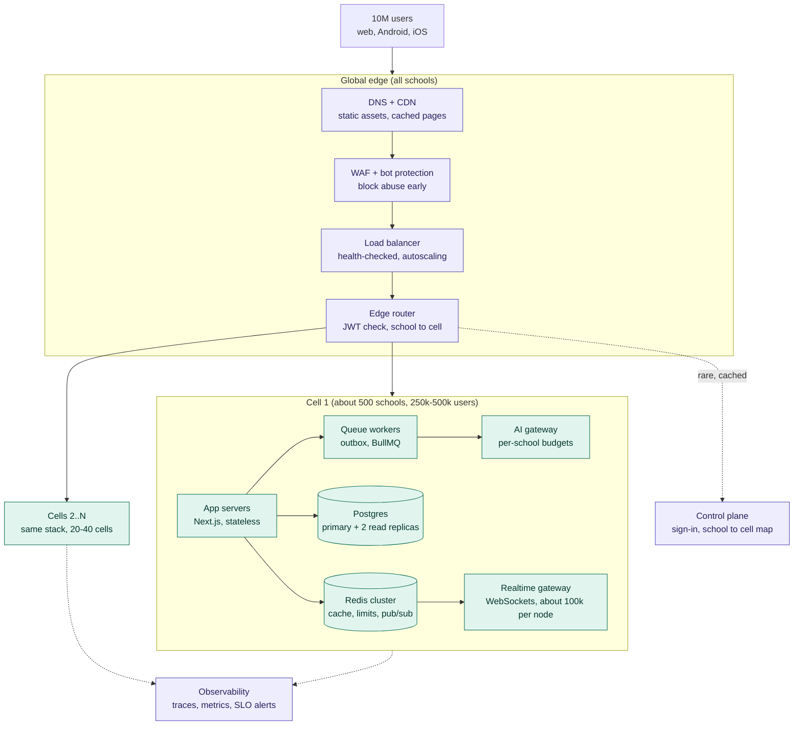

# Skoolee at 10 million concurrent users — scale architecture

Status: proposed (2026-11-12). Owner: platform. First slice: distributed rate limiting (this PR).

## 1. The target, in numbers

"10 million users at the same time" means 10M signed-in sessions with a browser tab or app open. Not all of them
are clicking. Working assumptions (to be replaced by real telemetry once SKO-451 capacity runs have prod data):

| Quantity | Assumption | Result |
|---|---|---|
| Concurrent sessions | target | **10M** |
| Average think time between requests | 30 s | **~330k req/s** steady |
| Peak multiplier (08:00 attendance, exam start, results day) | 3x, regional | **~1M req/s** peak |
| Open live connections (SSE / WebSocket) | 1 per session | **10M sockets** |
| Schools | ~1,000 students + staff + guardians each | **~10k–20k tenants** |
| Write share | ~10% (attendance, marks, chat, payments) | **~100k writes/s** peak |

A single Postgres primary handles roughly 20k–50k simple transactions/s. A single Redis node handles roughly
100k–200k ops/s and ~10k–50k client connections. So 10M users is not one bigger database; it is **many copies of
the same small system** (cells), with everything that can be shared moved to the edge or to caches.

## 2. What the code does today and why it breaks first

Ranked by what fails first as load grows. Each line is a measured fact from the current code, not a guess.

| # | Today | Where | Breaks at |
|---|---|---|---|
| 1 | Every authenticated request runs 3+ DB queries: session revocation, principal, active campus | `src/lib/auth.ts:61-65` | ~10k req/s on one primary. At 1M req/s that is 3M auth queries/s |
| 2 | Each SSE stream opens **its own Redis connection** | `src/app/api/notifications/sse/route.ts`, `src/app/api/chat/stream/route.ts` | ~10k–50k open tabs (Redis `maxclients`) |
| 3 | Rate limits live in process memory, per serverless instance | `src/lib/rate-limit.ts` | Day one: N instances = N× the limit, so signup/admissions limits do nothing |
| 4 | Auth rate limits write a Postgres row per attempt | `src/lib/auth/rate-limit.ts` | A credential-stuffing burst becomes write load on the primary |
| 5 | One database for every school; per-instance Prisma pool of 1 behind PgBouncer | `src/lib/db/pool-url.ts` | Pooler client limit, then primary CPU |
| 6 | No application cache (`unstable_cache` / `use cache` / Redis read-through: zero uses) | `src/` | Every page re-reads school config, timetables, fee structures |
| 7 | Capacity quotas (SKO-451) are per instance for requests | `src/lib/capacity/policy.ts` | Fairness only holds inside one instance |

What is already right and we build on:

- **`school_id` on every tenant row plus a fail-closed Prisma guard** (`src/lib/db/prisma.ts`). This is the single
  most valuable asset for scale: the school is a natural, already-enforced shard key.
- Service classes CRITICAL / INTERACTIVE / BACKGROUND with written SLOs (`src/lib/capacity/policy.ts`).
- Transactional outbox + BullMQ workers (`src/workers/outbox-worker.ts`) for side effects.
- Redis treated as optional with timeouts and a circuit breaker (`src/lib/chat/realtime.ts`).
- Offline-first class sync for teachers on weak networks.

## 3. Target architecture

Purple boxes are global and shared by every school; teal boxes are repeated in every cell.

### 3.1 Cells (sharding by school)

- A **cell** is a full copy of the stack serving a fixed set of schools. 20–40 cells cover 10M users with headroom.
- Routing: `schoolId → cellId` lives in the control plane, cached at the edge (it changes only when a school moves).
  The session JWT carries `cellId` so the edge routes without a lookup.
- Blast radius: a bad deploy, a noisy school or a DB incident hits one cell, never everyone. Deploys roll cell by cell.
- Cross-school features (school groups, owner console, platform analytics) read from the control plane or from an
  async-replicated warehouse, never across cell databases at request time.
- Moving a school between cells is a copy + dual-write + cutover job, possible because every row carries `school_id`.
- Prerequisite: no query may depend on rows from another school. The tenant guard already enforces this; the
  `runUnscoped` call sites are the audit list.

### 3.2 Request path: no database on the hot path for auth

- Edge verifies the JWT signature (already done in `src/proxy.ts`) and rejects bad tokens before the app.
- **Principal cache**: the resolved principal (role, campuses, permissions, `accessVersion`) is cached in Redis under
  `sess:{sessionHash}` with a 60 s TTL. Revoking a session or changing a user's access bumps `accessVersion` and
  deletes the key, so revocation stays immediate. Database is the fallback when Redis is down (fail safe, slower).
- Target: auth costs **0 DB queries** on a warm request, versus 3+ today.

### 3.3 Caching tiers (all keys tenant-scoped)

| Tier | What | TTL / invalidation |
|---|---|---|
| CDN | marketing pages, public forms shell, static assets, report-card PDFs by signed URL | immutable hashes / ISR |
| Next data cache (`use cache` + `cacheTag`) | school config, academic year, timetable, fee structures, class lists | tag `school:{id}:{area}`, revalidated on write |
| Redis read-through | dashboards counters, unread counts, principal | short TTL + explicit delete on write |
| Request memo | repeated reads in one render | per request |

Rule: **a cache key without a `schoolId` is a bug**. Cache helpers take the tenant context, never a free-form key,
so one school can never be served another school's cached data. Enforced by a test like the tenant guard's.

### 3.4 Data tier inside a cell

- Postgres primary for writes; **read replicas** for dashboards, reports, analytics and exports (Prisma read
  extension routes `findMany`/`count`/`aggregate` on replica-safe paths; read-your-writes paths stay on primary).
- PgBouncer in transaction mode; per-instance Prisma `connection_limit` stays small (current SKAI-1038 rule).
- Hot tables (attendance, marks, chat messages, audit, notifications) get **time-partitioning** by month and
  composite indexes leading with `school_id`.
- Heavy reports move to precomputed rollups refreshed by workers, not computed per page view.

### 3.5 Realtime at 10M sockets

- A dedicated **realtime gateway** fleet (Node WebSocket with SSE fallback, or a managed service such as
  Centrifugo/Ably), separate from the Next.js app so long-lived sockets do not hold serverless functions open.
- Each gateway node holds ~100k sockets and **one** Redis/NATS subscription, fanning out in process. 10M sockets
  ≈ 100–150 nodes, versus today's 10M Redis connections.
- Publishers stay as they are (`chat:{userId}` channels), so app code does not change; only the subscriber moves.
- Clients reconnect with jittered backoff and resume from the last event id; on gateway loss they fall back to the
  existing polling path (`sse-fallback.ts`).

### 3.6 Async work, AI and fairness

- Outbox and BullMQ queues are **per cell**, with separate queues per service class so a report batch never delays
  a payment confirmation or exam save.
- SKO-451 quotas become **distributed** (Redis counters per school per scope) instead of per instance.
- AI calls go through one gateway per cell: per-school token budgets, request coalescing, response caching for
  identical prompts, and graceful degradation (queue + notify) when the provider rate-limits us. Pseudonymisation
  rules in `docs/ai-provider-policy.md` are unchanged.

### 3.7 Protecting the system: limits and load shedding

- Three layers of rate limiting: edge/WAF (per IP, bot score), **distributed app limits** (per user, per school, per
  route; this PR), and per-school background quotas.
- Admission control by service class: under overload, shed BACKGROUND first, then slow INTERACTIVE, never CRITICAL.
- Every outbound call has a timeout and breaker (the `settle` pattern in `chat/realtime.ts`, made shared).

### 3.8 Client side

- Server Components by default; client JS budgets enforced by `size:check` per route group.
- Mobile web on cheap Android phones is the baseline device; the existing offline class sync covers weak networks.
- Polling intervals get jitter and back off when the tab is hidden, so 10M idle tabs do not synchronise into spikes.

### 3.9 Observability and proof

- OpenTelemetry traces with `schoolId`, `cellId` and `serviceClass` attributes; RED metrics per service class.
- SLOs are the existing SKO-451 `OBJECTIVES` (exam save p95 ≤ 800 ms, attendance p95 ≤ 1.5 s, error rates).
- Load profiles in k6 against a staging cell: **08:00 attendance storm, exam-start thundering herd, results-day
  parent spike, chat burst**. One cell must hold its target before we multiply cells.

## 4. Delivery plan

Each slice is one SKAI ticket, one branch, one PR under 400 lines, behind a flag where behaviour changes.

| Phase | Slice | Removes bottleneck # |
|---|---|---|
| 0 | **Distributed rate limiter** (Redis fixed window, timeout + breaker, memory fallback) — this PR | 3 |
| 0 | Shared Redis guard (`settle`) used by chat, limits and cache | — |
| 0 | Principal/session cache with `accessVersion` invalidation (auth: code-owner review) | 1 |
| 1 | Realtime gateway: one subscription per node, SSE routes become thin | 2 |
| 1 | Tenant-scoped cache helper + `use cache` for school config areas | 6 |
| 1 | Auth limiter moves from Postgres rows to Redis, Postgres kept as fallback | 4 |
| 1 | Distributed SKO-451 quotas | 7 |
| 2 | Read-replica routing for reports/dashboards; monthly partitions for hot tables | 5 |
| 2 | k6 load profiles + one-cell capacity proof against SLOs | — |
| 3 | Control plane (school→cell map, cell id in JWT, edge routing), second cell, school move tooling | 5 |
| 3 | Per-cell outbox/queues and AI gateway budgets | — |

Exit criteria per phase: the one-cell load test meets every SKO-451 objective at the phase's target concurrency
(Phase 1: 100k, Phase 2: 500k per cell, Phase 3: 10M across cells).

## 5. Decisions and trade-offs

- **Cells over one distributed SQL database.** Schools never share rows, so cells give linear scale and a small blast
  radius with plain Postgres and the Prisma code we already have. Distributed SQL would add cost and latency for
  cross-shard queries we do not need.
- **Redis is an accelerator, not a store.** Every Redis use has a fallback (memory or Postgres) so a Redis outage
  degrades speed, not correctness. Security limits fall back to the stricter path.
- **Fixed-window limits** over sliding-window: one round trip, one key, good enough at the edges we protect; the
  edge WAF handles burst smoothing.
- **Keep OpenAI as the AI provider**; scale work changes how calls are budgeted, not which model is used (AI-05 rule).

## 6. Running it on Vercel

The app already deploys to Vercel (`vercel.json`). Vercel provides the edge layer of the diagram out of the box:
its global network routes each request to the nearest location, balances it across function instances and scales
them automatically. We do not build or operate a load balancer. Our work is the data layer behind it, plus the two
pieces Vercel cannot run.

### 6.1 Mapping every box

| Box in the diagram | On Vercel | Notes |
|---|---|---|
| DNS + CDN | Built in | Cache public pages with ISR / `use cache` and `Cache-Control`; static assets are immutable |
| WAF + bot protection | Vercel Firewall | WAF custom rules, per-IP rate-limit rules, bot protection, managed rulesets |
| Load balancer + autoscaling | Built in | Turn on Fluid compute so one instance serves many concurrent I/O-bound requests |
| Edge router | `src/proxy.ts` (already runs on every request) | Put `cellId` in the session JWT so routing needs no lookup |
| App servers | Vercel Functions | Pin the function region next to the cell databases (e.g. `bom1` Mumbai, `dxb1` Dubai) |
| Redis cluster | Upstash Redis (Vercel Marketplace), one per cell | Works with the shared limiter in `src/lib/rate-limit.ts` (SKAI-1804) |
| Postgres | One Supabase project per cell | Supavisor pooler for runtime (`src/lib/db/pool-url.ts`), read replicas for reports |
| Realtime gateway | **Outside Vercel** | Vercel Functions cannot hold WebSockets open. Use a managed service (Ably, Pusher) or Centrifugo on Fly.io / AWS |
| Queue workers | **Outside Vercel** | BullMQ (`src/workers/outbox-worker.ts`) needs a long-running process: Railway, Fly.io or AWS ECS. Vercel Cron keeps scheduled jobs |
| AI gateway | Vercel AI Gateway in front of OpenAI | Adds budgets and logs; the provider stays OpenAI. Switching the gateway needs an AI-05 evaluation first |
| Control plane | A small separate database + Vercel Edge Config for the cell list and flags | The per-school map lives in the database; the token carries the cell |
| Observability | Vercel Observability + OpenTelemetry (`@vercel/otel`) | Log drains to Grafana or Datadog; SLOs from `src/lib/capacity/policy.ts` |
| Safe deploys | Rolling releases, skew protection, instant rollback | Roll out by percentage before 100% |

### 6.2 Cells on Vercel: one project, per-cell data

Start with **one Vercel project** for the whole app tier, because Vercel already scales it, and make only the data
per cell: each cell has its own Supabase database and Upstash Redis. On each request the app reads `cellId` from the
session and picks that cell's Prisma client and Redis client. One codebase, one deploy, and a database incident still
touches only that cell's schools.

Separate Vercel projects per cell only make sense later, for example to keep one country's data and compute in its
own region. The edge router would then rewrite to that cell's project.

### 6.3 Limits and costs to plan for

- **Plan:** 10M concurrent users needs Vercel Enterprise for function concurrency limits, spend controls and support.
- **Cost:** at ~1M req/s, function duration is the main bill. Every page served from the CDN or data cache instead of
  a function is money saved, so caching (§3.3) is a cost lever as much as a speed one.
- **Long-lived connections:** today each open tab holds an SSE function open on Vercel. At 10M tabs that is both the
  most expensive and the least scalable path, which is why the realtime gateway moves off Vercel first.
- **Function time limits:** long exports and AI batches belong in queue workers, not in request handlers.
