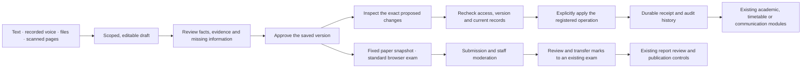

# School AI implementation and rollout

This change adds an integrated school workspace and a standard online assessment workflow. It does not complete the entire autopilot PRD. The requirement-by-requirement scope and remaining work are in [IMPLEMENTATION.md](IMPLEMENTATION.md).

The confirmed exam target is **standard browser exams without device lockdown** (user decision, 12 October 2026).

## What can be used

Authorized staff open **School AI workspace** from the shared sidebar, at `/ai`. Students open **My online exams**, at `/ai/exams`. Existing role dashboards and their operational records remain in place.

- Fullscreen setup asks one question at a time, adapts to new/import/migration paths and the first desired outcome, uses known school facts, and saves resumable drafts. Reviewed facts can be approved. Saving setup does not import rosters, post balances or silently create operational records.
- **Academic setup** saves a structured year/class proposal. After approving its exact version, staff review a create/keep preview and explicitly apply it. Existing teachers, pupils and classes are preserved; a new academic cycle stays DRAFT for the existing lifecycle controls. Conflicting/unfinished prior cycles block execution.
- **Bring your student roster** maps known English, Arabic and Urdu CSV headings into the existing admission workflow. Staff choose an active class, correct or exclude rows, review identity conflicts and explicitly create selected students. Required review hashes prevent stale/omitted reviews; live grant/class checks and serialized case-insensitive identity checks run before creation. Saved receipts support retry/resume. This does not import historical balances or overwrite existing pupils.
- School-wide managers explicitly select a campus; a sole campus can be preselected. Teacher scope is restricted to assigned subjects. Changing scope clears the chat, prevents late responses appearing under the new scope, and prompts for unsaved work. Chat sends only bounded successful exchanges in the current session; durable approved facts and drafts remain separate from this untrusted conversation context.
- Text, recorded voice, file upload and device-camera capture share a composer. Microphone permission failures preserve typed work. Transcription is editable before saving; this is not live voice conversation.
- **Scan multiple pages** collects up to 10 JPEG/PNG/WebP photos (8 MB total; 12 megapixels per photo). Cropping, rotation, reset and ordering happen locally; an explicit clarity/page-order check precedes saving. The server strictly decodes prepared images and creates a bounded PDF through the private intake path. Stalled requests can stop waiting while retaining pages and the same prepared file for retry. Photos are session-only until saved; there is no phone handoff, perspective correction or automatic blur judgment.
- **History & comparison** exposes paginated audit metadata and selected snapshots for every record kind. Staff compare saved versions, approve the current saved version, or restore a selected snapshot as a new draft with CAS protection. Historical entries retain current domain/subject/campus access checks.
- The source library retains private originals, extracted text and uncertainty. Image originals can be viewed beside editable text. PDFs are downloaded through an authenticated route. Explicit review is required before approval.
- Curriculum and paper authoring supports source excerpts/page references, taught/included outcomes, assessment blueprints, three question types, answer keys, rubrics, pinned questions, structural validation, version approval and candidate printing. Printing fetches a fresh permission-checked approved version and uses the same candidate projection as online exams, with no answer key or source metadata. A4 pagination, long prompts and EN/AR/UR text were rendered and visually inspected; other browser/printer/font combinations still need deployment checks.
- **Approved question bank** searches immutable approved paper revisions within the same campus, class, subject and language. Staff filter tags/type/marks/difficulty labels, map to current outcomes, review quoted evidence and insert a pinned copy into a draft. Copied options and rubric items receive fresh IDs; server checks reject forged provenance. Difficulty labels are not calibrated measurements, and quoted evidence does not prove semantic equivalence.
- **Reviewed timetable setup** prepares one weekly class schedule with explicit periods, times, teachers, subjects and rooms. A saved approved version produces an exact preview; applying creates one DRAFT timetable and a receipt. Current assignment, working-day, room and clash constraints are checked inside the transaction. Existing schedules are preserved; publishing remains a separate existing action. It does not automatically solve the school timetable. Both existing timetable editors select exact year/term/schedule, scope teacher/room views consistently and add blank periods to sparse drafts with safe retries. Manual edits, teacher assignment synchronization, subject deletion and AI creation share a campus transaction fence. Partial edits validate the full resulting board; an individual suggested fix must remove an existing critical conflict without introducing a new one, while regular saves and publication require no critical conflicts. Converting populated lessons to non-teaching periods shows a shared EN/AR/UR review of the assignments to clear. School owners can continue from a selected campus even without a default campus. Mixed manual/tool races, scope, cancellation and retry behavior were verified locally; production load remains a separate gate.
- **Import approved curriculum topics** previews the exact new and existing syllabus topics. Explicit confirmation writes missing topics into the existing syllabus module and records a receipt. It preserves manual topics and their progress.
- Standard online exams use approved paper snapshots, assigned students with active logins, server deadlines, sequenced autosave, reconnect/retry and final receipts. Choice marking is deterministic. Written marks require a staff reviewer.
- **Transfer reviewed marks** becomes available after the assignment window closes and every started attempt is moderated. A manager selects a compatible current-year exam, reviews exact marks or explicitly chooses proportional whole-mark conversion, then applies the current preview. Existing marks, absences or reports block the entire transfer; nonstarters are not silently assigned zero. Current permissions, roster, moderation and target exam state are rechecked inside the transaction. One durable receipt makes retries safe. Existing exam locking and report review/publication remain separate actions; no reports or notifications are automatically published.
- **Reviewed announcements** creates exact operational email variants in English, Arabic and Urdu. Staff choose classes and inspect verified eligible guardians, language selection, exclusions and exact text before approving and queuing. Siblings sharing a guardian are deduplicated; ambiguous contacts and missing translations block queuing unless an explicit available fallback is selected. Up to 200 active students and 100 recipients are supported per proposal. Queuing is transactional and does not synchronously send. The existing outbox worker rechecks approval, account access, guardian communication rights, scope, contact and language immediately before its fenced send. Provider acceptance is displayed separately from actual delivery/read receipts; uncertain outcomes are not retried automatically. SMS/WhatsApp, marketing consent and additional channel preference controls are not implemented.
- Managers can approve 0–240 extra minutes for an assigned student before the attempt starts. Start and approval serialize against the assignment version; an active attempt's deadline cannot be shortened or recomputed. The announced availability end remains a hard cap. Preflight checks real server connectivity and browser session storage, explains this timing, and offers practice text that never leaves the page. There is no offline answer persistence or recording.
- Workflow briefs and policies are editable, versioned records. Model-generated prose cannot execute arbitrary application APIs. Registered domain tools are `curriculum.import_topics`, `academics.setup_year`, `timetable.create_draft` and `communications.queue_announcement`; each needs its own reviewed preview and explicit application. Roster imports and gradebook transfers have separate exact-review contracts.

The interface supports English, Arabic and Urdu with shared controls, RTL layout, mobile layouts, reduced motion and unsaved-draft guards. Model output and extraction accuracy still require representative language and educational evaluation.

## Implemented review flow



The arrows describe implemented paths with explicit staff actions. They do not represent an unattended school-wide agent. History keeps saved versions, and editing an approved record requires a new review before it can be applied.

## Database installation

The additive migrations are:

1. `20261012090000_school_ai_workspace`: workspace records, immutable revisions, exam assignments and attempts.
2. `20261012100000_school_ai_execution`: completed typed-tool receipts.
3. `20261012110000_school_ai_requests`: bounded assistant request claims, exact reply receipts and explicit retry leases.
4. `20261012120000_school_ai_academic_execution`: per-student accommodation approvals and the academic-setup execution operation constraint.
5. `20261012130000_school_ai_timetable_execution`: extends the operation constraint for reviewed timetable drafts.
6. `20261012140000_school_ai_exam_expiry`: partial index for bounded due-attempt discovery.
7. `20261012150000_school_ai_gradebook_publication`: nullable immutable gradebook-transfer receipt on exam assignments.
8. `20261012160000_school_ai_announcement_execution`: extends the typed operation constraint for reviewed operational email.

Review the target environment and its migration history with `prisma migrate status`. After the existing history is correctly applied or baselined, deploy with the normal `prisma migrate deploy` workflow and run `prisma generate`. Do not use `db push --force-reset` on an existing school database. A database that was previously managed only with `db push` needs its existing schema baselined before deploying migrations.

Application tenant checks are always active. The additions in `prisma/rls.sql` support the repository's optional database RLS layer; that layer still requires a correctly configured non-owner database role and the existing RLS deployment procedure.

## Provider and storage configuration

Use [.env.school-ai.example](../../.env.school-ai.example) with the deployment's secret manager. Never commit real credentials.

- Text generation uses the existing approved OpenAI gateway. Select an evaluated model with `OPENAI_MODEL`; `OPENAI_API_KEY` remains server-only. Other destinations are not enabled for the new workspace.
- Document/audio egress is disabled by default. Enable `SCHOOL_AI_MEDIA_EGRESS_APPROVED=true` only for an approved deployment and set compatible `SCHOOL_AI_DOCUMENT_MODEL` and `SCHOOL_AI_TRANSCRIPTION_MODEL` values. The media client pins the official HTTPS OpenAI endpoint and refuses an unapproved `OPENAI_BASE_URL`.
- Originals use the existing private S3 configuration, or `SCHOOL_AI_STORAGE_DIR` pointing to a private, durable, absolute filesystem volume. Do not use `public/`, a source-code checkout, or an ephemeral serverless filesystem. Local files are created with restrictive permissions; canonical path checks reject public-directory symlinks and nested redirects across school folders. The volume must be controlled by the application operator; it is not a sandbox against another process with filesystem write privileges.
- Unconfigured extraction or exhausted AI credits leave a source available for manual review. Native UTF-8 text/CSV extraction needs no external model. Audio originals are not retained by the app's transcription route; provider retention must match the deployment's approved policy.
- Calls have bounded inputs, output validation and timeouts. Provider failures return generic errors. Raw prompts, audio and extracted source content are not written into AI usage logs.
- Announcements use the existing server-side email provider configuration and outbox worker. They refuse queuing while `EMAIL_DEV_MODE=true`, `DISABLE_OUTBOUND_MESSAGES=true`, or no real provider is configured. Keep these guards active in local tests; database tests use injected synthetic adapters and never send live email. Deploying the worker requires the existing Redis and database configuration. Provider acceptance alone is not proof of delivery; delivery/read statuses require verified receipts from the existing receipt integration.

Assistant requests claim a short lease before provider work; duplicate active requests are refused. A completed reply, optional workflow draft and one usage charge commit together. Failed/expired claims require an explicit user retry. After provider work, current access and the approved context versions are rechecked. These guarantees prevent duplicate application charges and saves; a network failure at an external provider can still have a provider-side cost.

Secure browser, managed-device lockdown, screen recording and remote proctoring are unavailable. Their API modes fail closed. A standard browser exam cannot block operating-system app switching or other browsers. The `/ai` permission policy permits user-approved microphone/camera access and disables screen capture until a real integration exists.

## Deadline processing

The existing `npm run worker:outbox` service now sweeps due standard exam attempts without a student reconnecting. It uses the PostgreSQL UTC clock against UTC timestamp columns, locks one attempt at a time with `SKIP LOCKED`, scores only persisted answers against the assigned snapshot, and commits one content-free system audit with submission. Written responses still require moderation. The stored submission time is the fixed deadline; the audit also records processing time.

The sweep handles up to 100 references per batch, continues full batches once per second, and checks again after 15 seconds when caught up. Invalid snapshots/answers remain unchanged and emit a count-only operational error; a cursor lets later deadlines progress. The privileged service database role must have the existing worker's cross-school dispatch rights. Deploy and monitor that service with the repository's Redis/worker configuration; adding application routes alone does not start it. Request-time expiry remains available as a fallback. No live worker was started against the configured school database during implementation.

## Reproducing local acceptance

The database test files refuse any target except the isolated PostgreSQL instance at `127.0.0.1:55438/postgres`. Browser fixtures use only synthetic schools and a fixed test-only signing secret. Never copy that secret into a deployment.

Pure tests:

```sh
npm run test:school-ai
npm run check:ui
```

For integration tests, first provision an empty local PostgreSQL instance at that port. Set both database URLs to the isolated fixture, create the baseline schema in that disposable database, and apply the School AI SQL constraints/migrations. Then:

```sh
export DATABASE_URL=postgresql://angular_dev_15@127.0.0.1:55438/postgres
export DIRECT_URL=postgresql://angular_dev_15@127.0.0.1:55438/postgres
export AUTH_SECRET=school-ai-isolated-browser-test-secret-only
npm run test:school-ai:db
npx tsx tests/school-ai/browser-fixture.ts
npx tsx tests/school-ai/assessment-browser-fixture.ts
```

The database script runs fixture files sequentially; concurrency scenarios inside each file still issue simultaneous requests. This separates unrelated school creation/deletion from the operation being tested. Running all eight fixture suites concurrently against the small shared database exhausted bounded serialization retries in one timetable setup (130/131 passed); it returned a safe 409 and wrote no partial schedule. Sustained multi-school load and retry rates remain an explicit deployment gate. Retries are bounded to seven attempts, apply only to known rolled-back database conflicts, and never repeat external sends. Production exam retries sample current server time so a delay cannot admit late starts or answers.

Start a separate local test server with no external AI credentials:

```sh
env OPENAI_API_KEY= SCHOOL_AI_MEDIA_EGRESS_APPROVED=false EMAIL_DEV_MODE=true \
  SCHOOL_AI_STORAGE_DIR=/private/tmp/skoolee-ai-test-documents \
  NEXT_BUILD_DIR=.next/school-ai-tests npx next dev --hostname 127.0.0.1 -p 3106
```

In a second terminal with the same isolated database settings, run `npm run test:school-ai:e2e`. Reseed the assessment fixture before rerunning the complete browser suite because those tests intentionally submit and moderate their synthetic exam. Run browser files serially: several share the synthetic school's locale and attempts. Academic setup and assistant scope tests create their own temporary schools. Restart the test server after Prisma schema/client changes. Generated tokens, screenshots and reports belong in ignored `test-results/`, never in the commit. An alternate `NEXT_BUILD_DIR` avoids disturbing another dev server; Next may add its generated type paths to `tsconfig.json`, which are local test artifacts and should be removed after verification.

## Acceptance boundaries

Final local checks on 12 October 2026: `npm run build` passed (Prisma generation, commercial contract, shared UI checks, TypeScript and Next production output); 87 pure tests, 131 controlled-fixture database tests, 76 distinct Chromium browser cases and 3 shared UI checks passed. Changed-file ESLint, Prisma schema validation and whitespace checks passed. The route inventory contains 87 pages, 17 layouts, 12 loading boundaries, 13 error boundaries and one not-found boundary; the detailed [UI coverage matrix](IMPLEMENTATION.md#route-and-interaction-coverage) preserves UNVERIFIED cases. Production build output and synthetic evidence remain outside the commit.

Local tests cover the implemented state transitions, access checks, retries, shared UI and standard browser exam lifecycle. They do not certify live OCR/transcription/paper generation quality, S3 policy configuration, representative accessibility assistive technology, high-concurrency examination load, native device lockdown or production recovery.

Before a school pilot, finish the relevant PRD gates: retention/deletion and backup recovery, provider calibration, additional accommodation types, worker monitoring, live provider delivery verification, further operational tool validation and a supported device matrix. The implementation ledger keeps every unfinished requirement visible.
